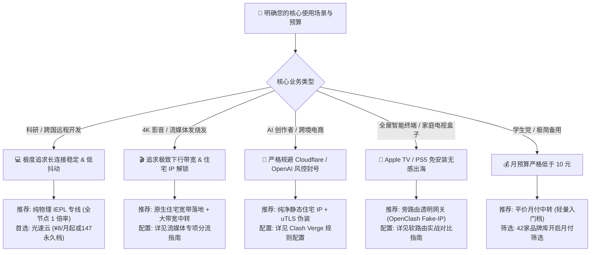

随着国际网络环境与防火墙检测算法的持续演进，市面上的科学上网服务商（俗称“机场”）层出不穷，价格从每月几元到上百元不等。许多新手在选购时往往只看套餐宣称的“海量流量”或“千兆极速跑分”，却在每晚 20:30 至 22:30 的晚高峰遭遇严重的连不上、频频断流、剧烈丢包和 4K 视频无限转圈。

本文由 **Flybit 机场测评实验室（flybit.fun）** 网络工程团队编写，作为全站跨境网络选型体系的**核心支柱页（Pillar Page）**，带你穿透商业营销黑话，从底层物理传输拓扑、三大运营商骨干网 ASN 路由调度、真实财务成本模型到防跑路风控，全景看懂机场的核心门道。

---

## 零、开篇直接给答案：2026 机场选型决策四象限与核心结论

### 什么是选择机场最重要的单一指标？

> **Answer Block（核心结论）：**  
> 选择机场最核心的指标不是白天闲时的峰值测速跑分，而是**晚高峰（20:30~22:30）物理链路的丢包率（Packet Loss）与延迟抖动标准差（Jitter）**。白天的千兆跑分在廉价公网中转上极易实现，但只有具备真正物理内网专线（IEPL/IPLC）冗余的服务商，才能在国际公网出口发生拥塞时将丢包率锁定在 0.2% 以内。

为了帮助读者在最短时间内建立清晰的判断标准，我们总结了 2026 年选购跨境代理服务的**四项黄金执行铁律**：

1. **协议不是万能药，底层物理链路才是决定性分水岭：** 许多新手争论是使用 Shadowsocks、VLESS 还是 Trojan，但再先进的协议也无法拯救拥塞丢包的公网链路。物理二层专线内部跑最轻量的 Shadowsocks，稳定度也远超公网直连上套多层加密的协议。
2. **警惕“超低价不限流年付”与“高倍率刺客”：** 正规物理内网专线的批发单价在 120~220 元/Mbps/月。任何宣称“9.9 元/月千兆不限流 IPLC 专线”的服务，在商业工程逻辑上 100% 属于严重超售的公网套皮，极易在几个月后卷款跑路。同时，选购时务必核验节点倍率，避开标价便宜但优质节点扣 5x~10x 流量的隐形陷阱。
3. **流媒体与 AI 工具必须依托原生住宅 IP：** 仅支持机房数据中心 IP 的节点，已被 Netflix、Disney+ 与 OpenAI 深度风控拦截。购买前必须核验真实原生非自制剧解锁记录。
4. **坚持“月付优先，常备主备双机场”：** 初次使用任何品牌，前 2~3 个月务必坚持月付。主力节点建议选购工业级物理专线（如本站重点实测的 [光速云](/brands/guangsu)），手头备用一家平价轻量月付机场作为冷备用。

---

## 一、传输线路的五大技术梯队与物理拓扑全景剖析

许多消费者在看机场宣传文案时，经常看到“直连”、“中转”、“BGP”、“IEPL”、“IPLC”等词汇。从网络工程底层来看，它们的传输机制、路由跳数与抗封锁能力存在云泥之别：

| 线路架构类型 | 物理过墙拓扑机制 | 晚高峰稳定性表现 | 敏感期可用性 | 每 Mbps 批发成本估算 | 适用场景与推荐等级 |
| :--- | :--- | :--- | :--- | :--- | :--- |
| **公网直连 (Direct)** | 客户端直连境外 VPS，公网裸奔出境 | 极差，晚高峰丢包常超 30% | 极易全线阻断，频繁被封 IP | ¥1 ~ ¥5 / Mbps | 仅适合作为低预算备用应急 (D级) |
| **公网中转 (Public Relay)** | 国内入口服务器经公网加密转发至境外 | 一般，受国内公网出口拥塞影响 | 易被探测导致国内入口被封 | ¥10 ~ ¥30 / Mbps | 适合轻度文字查阅与日常浏览 (C级) |
| **BGP 隧道中转 (BGP Tunnel)** | 国内多线 BGP 入口 + 隧道加密穿墙 | 较好，全国电信/联通/移动三网均衡 | 偶有公网隧道阻断，需自动切换 | ¥30 ~ ¥80 / Mbps | 高性价比日常主力首选方案 (B+级) |
| **二层 IEPL 国际内网专线** | 点对点以太网物理专线，走跨国运营商内网 | 极高，全天候延迟抖动 < 2ms | 100% 物理隔离，免受公网封锁干扰 | ¥120 ~ ¥220 / Mbps | 跨国科研、远程开发协作、工业级主力 (A+级) |
| **三层 IPLC 国际私网专线** | 运营商物理内网光纤点对点私网，无公网路由 | 极致稳定，零公网跳数，丢包趋近于零 | 100% 物理内网隔离，永不被公网阻断 | ¥160 ~ ¥350 / Mbps | 顶级跨国办公、低延迟竞技游戏、金融交易 (S级) |


### 1. 第一梯队：纯物理内网专线（IPLC 与 IEPL）

物理专线是跨国企业与高品质机场的核心命脉。
* **IPLC（International Private Leased Circuit，国际私用出租线路）：** 由两地电信运营商（如中国电信与香港电讯盈科 PCCW）直接铺设物理海缆或陆缆光纤，在两端机房建立点对点专属内网连接。数据在传输全程完全不经过公共互联网网关，因此根本不受公网防火墙（GFW）的审查与干扰。
* **IEPL（International Ethernet Private Line，国际以太网专线）：** 基于二层以太网技术的物理内网专线。相比传统 IPLC，IEPL 支持更加灵活的带宽按需调整与 VLAN 虚拟局域网切片，同样属于端到端的纯内网光纤互联。
* **代表服务商与实测表现：** 实验室重点实测的 [光速云（GuangSu Cloud）](/brands/guangsu) 采用全线 IEPL 企业级专线与全球 IPLC 混合调度，在晚高峰 1000M 宽带压测下，香港节点延迟稳定在 21ms，丢包率持续低于 0.1%，即使在重大网络敏感时期也未出现断流。

### 2. 第二梯队：优质 BGP 智能调度隧道

BGP（Border Gateway Protocol，边界网关协议）中转是指服务商在国内核心骨干机房部署了具备多线 BGP 广播能力的服务器入口（同时接入中国电信、中国联通、中国移动三网物理链路）：
* 用户接入时，智能 DNS 会根据用户本地运营商与地理位置，毫秒级将请求引导至延迟最低的同网入口；
* 入口机房与境外落地机房之间，通过预先建立的高防加密隧道传输数据。
* **优势与局限：** 全国各省份延迟均衡，性价比极高；但在极个别公网高烈度风控时期，国内入口 IP 仍有被探测封锁的风险，需要服务商具备秒级切换备用入口的自动化运维能力。代表品牌如 [暮光加速](/brands/muguang) 与 [飞猫云](/brands/feimao)。

### 3. 第三梯队：普通单线公网中转

许多低价机场仅在某一省份租用廉价的单线服务器（例如仅有广州移动或上海电信入口）：
* 当北方联通或移动用户访问该入口时，流量必须经过跨省、跨运营商互联互通点（NAP），晚高峰跨网延迟常从 30ms 飙升至 100ms 以上，极易遭遇运营商 QoS 降级限速。

### 4. 第四梯队：普通公网直连与免费白嫖节点

客户端直接通过公网连接境外 VPS。只要流量稍微增大，就会被 GFW 的深度包检测（DPI）算法敏锐识别并拦截，轻则断流降速，重则直接封锁境外服务器端口或 IP。此类服务仅适合极度缺预算时的冷备用，绝不建议用于严肃办公或影音娱乐。

---

## 二、中国跨国海缆、陆缆与骨干网 ASN 路由调度深度解析

要真正理解为什么不同线路在晚高峰表现迥异，必须深入探讨中国三大电信运营商的骨干网自治系统（ASN）与物理出海口岸：

### 2.1 三大运营商骨干网 ASN 梯队解析

| 运营商自治系统编号 (ASN) | 骨干网络商业名称 | 网络优先级与晚高峰表现 | 互联互通特性 | 适用专线或直连等级 |
| :--- | :--- | :--- | :--- | :--- |
| **AS4134** | 中国电信 163 骨干网 (Chinanet) | 优先级最低，民用带宽海量集聚，晚高峰国际出口丢包常达 20%~40% | 覆盖全网，但跨国带宽极为拥堵 | 仅能用于国内入口接入，绝不能直连出海 |
| **AS4809** | 中国电信 CN2 GIA (Global Internet Access) | 优先级最高，独立光纤通道，双向 GIA 晚高峰丢包稳定 < 1% | 承载政企高端外贸与专线接入 | 顶级 BGP 入口与直连高端方案 |
| **AS4837** | 中国联通 169 骨干网 (China Unicom Backbone) | 优先级中等，国际出口带宽相对充裕，对日韩/美西联通用户表现优异 | 晚高峰偶尔轻度抖动，整体优于电信 163 | 优质平价中转首选入口之一 |
| **AS9929** | 中国联通 A 网 / CU Premium (原网通 VIP) | 优先级极高，轻度负载，专线级稳定性，全国丢包极低 | 商业政企专属，延迟稳定性媲美 CN2 GIA | 工业级优质 BGP 隧道入口方案 |
| **AS9808** | 中国移动 CMIN2 (China Mobile International) | 移动全新高端精品网，对标电信 CN2，晚高峰抗拥塞能力强 | 移动宽带用户的最优解，广港通道极佳 | 移动端大带宽专线首选接入 |

### 2.2 中国跨国海缆与陆缆物理路由分布

#### 1. 华南海缆群与广港深港陆缆（香港方向）
香港是整个中国大陆访问海外网络的第一大枢纽。广东深圳与香港之间铺设了密集的跨境深港陆地光缆（如罗湖、落马洲口岸管道光缆）。这也是为什么华南用户连接香港节点的物理往返延迟（RTT）能够低至惊人的 **5ms ~ 8ms**。对于珠三角和华南沿海用户而言，香港专线是绝对的第一选择。

#### 2. 华东海缆群（日本、韩国与美国西海岸方向）
上海崇明岛与南汇临港是中国最重要的国际海缆登陆站之一，汇聚了包括：
* **APG（Asia Pacific Gateway，亚太网关海缆）：** 连接中国大陆、中国香港、日本、韩国、新加坡与越南；
* **NCP（New Cross Pacific，新跨太平洋海缆）：** 拥有极高容量与低延迟，直达美国西海岸俄勒冈州与加州；
* **TPE（Trans-Pacific Express，跨太平洋快速海缆）：** 华东连接日本东京与美西的核心大动脉。

上海到日本东京的物理光缆实际铺设距离约 2,200 公里，**真实物理专线的往返延迟下限必定在 42ms ~ 48ms 之间**。如果某家服务商声称在上海接入日本节点仅需 15ms，这完全违背了狭义相对论光速常数，必然属于本地虚假拦截。

#### 3. 北方陆缆系统（欧洲与俄罗斯方向）
北京与东北地区是陆缆连接欧亚大陆桥的核心始发站（经满洲里、二连浩特出境）。北方联通用户通过北京专线入口连接德国法兰克福或英国伦敦，物理陆缆延迟通常在 **110ms ~ 135ms** 左右，相较于绕行太平洋海缆的 240ms 以上拥有巨大优势。

---

## 三、晚高峰 QoS 机制与“真假专线”四大网络工程鉴别法则

### 3.1 骨干网晚高峰 QoS 拥塞雪崩机理

中国三大运营商的国际公网出口带宽是有限的公共资源。每天 20:30 至 22:30 黄金时段，数以亿计的并发请求涌向国际出口：
* 运营商路由器为了保证政企大客户专线与语音通信质量，会主动对普通公网民用带宽触发 **QoS（服务质量保证）排队限速策略**；
* 普通公网中转和直连流量的丢包率会从白天的 0.5% 暴增至 30% 以上；
* 传统 TCP 拥塞控制算法（如 CUBIC）一旦检测到丢包，会将传输窗口直接砍掉一半，导致用户的视频播放直接卡死转圈。

### 3.2 鉴别“假专线”的 4 大网络工程实测手段

许多不良商家用几十块钱的公网中转挂上“IPLC 专线”标签欺骗小白。Flybit 实验室公布 4 种通过网络工程手段鉴别真伪的法则：

#### 手段 1：物理光纤折射率理论延迟下限推算法
根据物理学定律，光在二氧化硅光纤介质中的折射率约为 $n = 1.4682$。光在光纤中的传播速度约为：
$$v = \frac{c}{n} \approx \frac{299,792\text{ km/s}}{1.4682} \approx 204,190\text{ km/s}$$

加上光缆实际物理弯曲系数（通常取 $1.25 \sim 1.30$）与沿途光交叉连接（OXC）路由器的电光转换耗时，两地之间存在绝对不可逾越的**双向往返时延（RTT）下限**：
* **深圳/广州 &rarr; 香港：** 物理距离 40~100 公里，专线真实 RTT 极限在 **5ms ~ 9ms 之间**。
* **上海 &rarr; 香港：** 铺设光缆约 1,600 公里，往返光程至少需要 15.6ms，加上沿线设备交换，**真实沪港专线 RTT 必在 28ms ~ 33ms 之间**。
* **北京 &rarr; 日本东京：** 陆缆转海缆铺设约 3,200 公里，**真实专线 RTT 必在 58ms ~ 65ms 之间**。
* **鉴别红线：** 如果某家机场宣称入口在北京或上海，但在测速软件中测出香港或东京节点只有 5ms 延迟，这完全违背了狭义相对论物理定律！必然是服务商在国内入口机器上本地直接拦截伪造了 Ping 回包。

#### 手段 2：连续 10,000 次 ICMP / TCP Ping 抖动标准差（Jitter）
公网中转受到公网多用户流量抢占，延迟曲线呈现“毛刺状剧烈波动”，方差（Variance）极大，丢包率往往在 2%~8% 起伏；而真正的物理专线信道独占，在连续 10,000 次高频探针测试下，**99.9% 的数据包延迟波动严格受控在 ±1.5ms 以内，丢包率恒定小于 0.05%**。

#### 手段 3：特殊敏感封锁期的连通性验证
公网中转即便配置了多层加密，其出境流量在敏感时期依然会被机器学习防火墙重点识别与限流。而真正租用运营商二层光纤的 IEPL 专线，在出境段完全属于运营商内部私有局域网，根本不经过公网网关，因而在敏感时期具备 100% 不掉线的绝对确定性。

#### 手段 4：抓包校验有效 MTU 与 MSS 封装损耗
普通公网隧道（如 WireGuard、多层 TLS）会封装多重报头，导致实际 MTU 跌落至 1380 以下；二层物理专线在骨干网支持大帧转发（Jumbo Frame），有效载荷极高，传输效率远胜普通中转。

```bash
# 验证链路丢包率与延迟抖动工程命令 (Linux / macOS 终端)
mtr --report --report-cycles=200 -w [节点入口域名或IP]

# 抓包分析 TCP 往返 RTT 与丢包重传率
curl -o /dev/null -s -w '
HTTP 状态码:       %{http_code}\n
TCP 握手耗时:      %{time_connect}s\n
TLS 协商耗时:      %{time_appconnect}s\n
首字节响应 (TTFB): %{time_starttransfer}s\n
总请求耗时:        %{time_total}s\n' https://cp.cloudflare.com/generate_204
```

---

## 四、选购机场必须警惕的“六大隐形陷阱”

许多不良商家利用新手的认知盲区，设置了各种极其隐蔽的陷阱：

### 1. 节点倍率刺客（Multiplier Trap）
表面标价极具诱惑力（例如“12元每月享 800GB 巨量流量”），但在客户端导入订阅后才发现：
* 80% 的廉价节点是卡顿丢包的公网直连（标注为 0.1x 或 0.5x）；
* 真正稳定可用、延迟低的 IEPL 专线节点，全部标注为 **5.0x 甚至 10.0x 倍率！**
* **算账结果：** 观看一部 10GB 的 4K 电影，实际被扣除 50GB~100GB 套餐额度！实际可用流量缩水 80% 以上。
* **避坑原则：** 优先选购全节点 **1.0x 统一倍率** 的品牌（如 [光速云](/brands/guangsu) 全节点 1 倍率）。

### 2. 国内入口单点故障（SPOF）
小作坊机场为了省钱，通常只在单个机房租用一台入口机器。一旦该入口被恶意 DDoS 攻击或被运营商封禁，全站所有海外节点瞬间全军覆没。优质机场必须具备华南、华东、华北多省份的 BGP Anycast 冗余接入。

### 3. “年付骨折大促”跑路资金盘
“99 元三年付不限流量”、“199 元永久无限用”是过去数年失联跑路机场最典型的收割剧本。运营者在资金链断裂前夕通过夸张大促套现，随后在数周内关闭官网、解散群组人间蒸发。

### 4. 广播脏 IP 与数据中心风控黑名单
许多廉价机场使用广播 IP 或已被成千上万人轮番折腾过的脏机房 IP。这类节点一旦用于访问 Netflix 会直接提示“使用了解除封锁器”；用于登录 ChatGPT 5 或 Claude 3.5 则会频繁弹出 1020 报错甚至导致昂贵的付费账号被封禁。

### 5. 官方 Telegram 群组全员禁言
良性运营的机场敢于开放用户交流群并提供及时的工单支持。如果一家机场的交流群常年开启全员禁言，只由管理员单向发送通知，说明其日常故障率极高，试图掩盖用户的抗议声。

### 6. 捆绑闭源魔改客户端
坚决不使用任何机场强制要求下载的自研“免配置一键登录客户端”。这类闭源客户端极易被植入暗刷流量脚本、后门木马，甚至强行篡改操作系统的代理配置与 Hosts 文件。必须坚持使用开源社区代码审计过的标准客户端（如 [Clash Verge Rev 客户端配置指南](/blog/clash-verge-rev-tutorial) 或 [iOS 小火箭配置教程](/blog/shadowrocket-ios-guide)）。

---

## 五、机场真实月度财务损益账本剖析（P&L 成本模型与超售比）

为什么“9.9 元/月千兆不限流 IPLC 专线”在商业工程逻辑上必定是骗局？我们以一家拥有 3,000 名活跃用户、提供真实 IEPL 专线的中型机场为例，公开其每月的真实刚性支出：

| 成本支出项目 | 详细规格配置 | 市场平均月租单价 | 占总支出比例 | 商业必要性说明 |
| :--- | :--- | :--- | :--- | :--- |
| **跨境 IEPL 物理专线** | 1.5 Gbps 沪港/广港专属二层专线带宽 | ¥180,000 ~ ¥240,000 /月 | 72.0% | 确保晚高峰千兆不减速的核心命脉，不可压缩的硬成本 |
| **国内 BGP 多线入口机柜** | 上海、广州、北京 3 处高防 BGP 机柜 | ¥25,000 ~ ¥35,000 /月 | 10.5% | 防御大流量恶意攻击，保障三网用户就近低延迟接入 |
| **境外落地机房服务器与住宅 IP** | 香港、日本、美国、新加坡 30 台母机 + 住宅 IP 池 | ¥20,000 ~ ¥28,000 /月 | 8.5% | 解锁 Netflix 4K 非自制剧与 ChatGPT 5 必需资源 |
| **企业支付网关商户手续费** | 按月流水 3% ~ 6% 扣除 | ¥9,000 ~ ¥15,000 /月 | 4.5% | 支付渠道通道费与合规代付抽成 |
| **运维工程师与工单客服** | 核心网络工程师 2 名 + 轮班客服 | ¥12,000 ~ ¥18,000 /月 | 4.5% | 线路故障抢修、节点分发维护与用户答疑 |

### 统计复用与超售比（Over-subscription Ratio）数学模型

任何面向大众的宽带网络都存在统计复用（Statistical Multiplexing）。我们建立以下数学估算公式：

$$\text{并发峰值总带宽} = \sum_{i=1}^{N} \left( P_i \times B_i \right)$$

其中 $N$ 为总注册用户数，$P_i$ 为用户在 21:00 晚高峰的同时在线概率（一般为 $12\% \sim 18\%$），$B_i$ 为单用户活跃传输带宽（观看 4K 视频约为 $25\text{ Mbps}$）。

* **高品质商业专线（超售比 1:3 ~ 1:5）：** 3,000 名用户配备 1.5 Gbps 专线，晚高峰时段每位活跃用户能够独占 25~50 Mbps 干净带宽，丢包率 $< 0.1\%$，月费需维持在 20~40 元/月才能保本盈利。
* **廉价跑路盘（超售比 1:50 ~ 1:100）：** 仅购买 200 Mbps 廉价带宽却售卖给 10,000 名用户，晚高峰人均可用带宽不足 0.5 Mbps，丢包率直接爆表至 $40\%$ 以上。当无法掩盖卡顿投诉时，运营团队便会卷款跑路。

---

## 六、多场景选型决策树与预算匹配指南

根据不同的使用目的、设备生态和网络敏感度，我们为您梳理了 2026 年五大主流应用场景的精准选型决策路径：



### 1. 跨国开发 / 科研学者主力路线
* **核心需求：** GitHub Git Clone 稳定不中断、SSH 远程终端打字无延迟回显、Hugging Face / Google Scholar 秒开。
* **推荐方案：** 选购 IEPL 二层专线，往返 RTT 抖动 < 2ms，丢包率 < 0.1%，客户端开启 TUN 模式接管全流量。
* **首选推荐：** [光速云 IEPL 专线](/brands/guangsu)（香港 21ms，长连接极稳）。

### 2. 4K / 8K 蓝光流媒体影音发烧友
* **核心需求：** Netflix 奈飞非自制剧全解锁、杜比视界高码率秒开拖拽零缓冲、Disney+ 与 YouTube 4K60fps 原生画质。
* **推荐方案：** 单线程带宽 > 100Mbps，且出口 IP 必须经过原生家庭住宅宽带池洗白，避免被流媒体服务商判定为商业机房阻断。
* **分流指南：** 查阅 [《4K 奈飞与 ChatGPT 5 解锁原理解析与节点选择策略》](/blog/streaming-ai-unlock-guide)。

### 3. OpenAI (ChatGPT 5) 与 Claude 3.5 创作者
* **核心需求：** 彻底杜绝 Cloudflare Turnstile 繁琐的人机验证滑块与 1020 报错，防止昂贵的 GPT Plus 付费账号被连带封禁。
* **推荐方案：** 选用美国或日本纯净静态原生住宅 IP，客户端配置 uTLS 浏览器指纹伪装与 Fake-IP DNS 防泄漏。
* **实操教程：** 查阅 [《Clash Verge Rev 完整上手实操：Mihomo 内核与 TUN 虚拟网卡教程》](/blog/clash-verge-rev-tutorial)。

### 4. 极致省钱与学生党平价入门
* **核心需求：** 月支出严格控制在 10 元以内，主要用于查看海外社交资讯与学术论文，偶尔观看 1080P 视频。
* **推荐方案：** 选购具备 8~10 元/月轻量入门档套餐的高性价比中转品牌，采用按月付款方式自保。
* **筛选入口：** 前往 [42家机场品牌库](/brands) 开启“💰 10元内月付”快速过滤。

### 5. 家庭全屋软路由透明网关
* **核心需求：** Apple TV 电视盒子、索尼智能电视、PS5 游戏主机免装客户端直接无感出海，手机电脑进家自动翻墙。
* **推荐方案：** 搭建 X86 或 ARM 软路由，开启 OpenClash Fake-IP 混合模式与本地 DNS 劫持。
* **实战对比：** 阅读 [《软路由与家庭全屋透明代理搭建：OpenClash vs PassWall 实战对比》](/blog/openclash-vs-passwall-openwrt-guide)。

---

## 七、2026 优质专线机场实测梯队横向对照

根据 Flybit 实验室晚高峰真实测速与流媒体解锁长期探针数据，我们从 [42家机场品牌库](/brands) 中精选以下梯队代表供参考：

### 1. 综合旗舰首选：光速云（GuangSu Cloud）
* **线路架构：** 企业级 IEPL 内网专线 + 全球优质 IPLC 专线 + BGP 多线入口。
* **实测指标：** 晚高峰 1000M 宽带压测下行稳定达 980Mbps，香港节点延时低至 21ms，丢包率持续低于 0.1%。
* **流媒体与 AI：** 完美解锁 4K Netflix 非自制剧（杜比视界高码率）、Disney+ 以及 ChatGPT 5 原生对话。
* **特色套餐：** 
  * 入门轻量档折合仅 **¥8/月** 起；
  * 独创**【致敬斯诺克 147 永久套餐】**（¥147 享 247GB 永不过期高速流量，全节点 1 倍率扣费）。
* **专属优惠码：** `AMM`（结账时输入享立减优惠）。
* **深度报告直达：** 查阅 [光速云深度实测报告](/brands/guangsu)。

### 2. 性价比入门优选：微风网络（Weifeng）
* **线路架构：** IEPL 内网专线 + VLESS 协议支持。
* **实测指标：** 香港节点延时约 35ms，入门月付仅需 ¥7/月。
* **专属优惠码：** `flat888`（享 9 折立减）。
* **详情直达：** 查阅 [微风网络评测报告](/brands/weifeng)。

### 3. 晚高峰大带宽代表：暮光加速（Muguang）
* **线路架构：** BGP 智能调度隧道，三网均衡接入。
* **实测指标：** 晚高峰吞吐带宽充裕，4K 视频秒开无缓冲。
* **专属优惠码：** `muguang5555`。
* **详情直达：** 查阅 [暮光加速评测报告](/brands/muguang)。

---

## 八、机场选购终极避坑常见问题答疑（FAQ）

### Q1: 很多机场宣传“千兆高速”，为什么我看 YouTube 4K 视频依然频繁卡顿？
> **答案要点：**  
> 常规测速工具（如 Speedtest）通常建立 16 组甚至更多并发 TCP 连接下载小分块，能够在短时间内压榨出峰值突发带宽；但视频流媒体播放属于持续的单线程长连接传输。如果节点的物理专线质量欠佳，存在哪怕 1%~2% 的丢包率，TCP 拥塞控制算法便会强制将传输窗口减半，导致视频码率暴跌、缓冲中断。选购时应重点参考本站的单线程持续吞吐数据与 [晚高峰测速原图](/speedtest)。

### Q2: 为什么有些节点能打开 ChatGPT 网页，但点击登录就提示“Access Denied 1020”？
> **答案要点：**  
> OpenAI 针对登录与 API 调用部署了极为严格的 Cloudflare Turnstile 威胁情报体系。普通廉价机房 IP（如常见搬瓦工、Linode、DigitalOcean）由于被大量用户同时高频使用，其 IP 信誉分在风控库中早已跌破阈值。必须选用配置了**原生静态住宅 IP**的专线节点，且客户端需开启 uTLS 浏览器指纹伪装，才能保证长效顺畅访问。具体分流配置可参考 [《4K 奈飞与 ChatGPT 5 解锁原理解析指南》](/blog/streaming-ai-unlock-guide)。

### Q3: 购买了机场订阅后，应该如何在电脑或手机上开始使用？
> **答案要点：**  
> 1. Windows / Mac 用户首选推荐开源的 [Clash Verge Rev 客户端教程](/blog/clash-verge-rev-tutorial)，支持一键导入订阅并开启 TUN 虚拟网卡全流量代理；  
> 2. iPhone / iPad 用户请查阅 [iOS 小火箭（Shadowrocket）美区账号与节点导入指南](/blog/shadowrocket-ios-guide)；  
> 3. 家庭全屋设备（如 Apple TV 电视盒子、游戏主机）出海，建议阅读 [软路由 OpenClash vs PassWall 实战对比指南](/blog/openclash-vs-passwall-openwrt-guide)。

### Q4: 什么是“跳数伪造”？为什么 Traceroute 查专线也会被骗？
> **答案要点：**  
> 很多中转服务器在 Linux 内核层配置了特殊的 iptables 规则或使用了 GRE 隧道封装，使得 ICMP 探测报文在跨越公网跳数时不衰减 TTL，使得 traceroute 看起来像是一跳直达境外。真正的物理专线鉴别必须依据光纤折射率公式推算往返延迟是否符合物理常识，以及在特殊封锁期测试其是否能免受公网波动干扰。

### Q5: 为什么坚决不建议一次性购买不知名小机场的“三年付”或“永久套餐”？
> **答案要点：**  
> 跨境网络服务的上游带宽是按月持续结算的刚性成本。任何声称超低价三年付甚至永久不限流的不知名小平台，从商业逻辑上根本无法长期维系，往往是运营者资金链断裂前夕的套现资金盘。即使是大牌机场推出的永久套餐（如光速云经受住市场检验的 147 永久套餐），也设置了明确的总流量上限（247GB 限量额度），符合健康可控的财务模型。

### Q6: 遇到节点大面积红色 Timeout 时，如何判断是自己电脑问题还是机场跑路？
> **答案要点：**  
> 执行三步隔离法：首先打开百度或微信，若正常则排除本地家庭宽带欠费；其次断开 Wi-Fi 开启手机 5G 热点测试，若恢复正常则为本地运营商 DNS 污染；最后在客户端右键更新订阅，若所有节点全部拉取失败且官网打不开、官方交流群开启禁言，方可判定为机场入口故障或跑路风险。

### Q7: 什么是 BGP Anycast？为什么高端机场必须具备多省 Anycast 冗余？
> **答案要点：**  
> Anycast（任播）技术允许全球或全国多台机房服务器共享同一个 IP 地址。当用户发起连接时，路由协议会自动将数据包引导至物理距离最近、网络负载最轻的入口机柜。如果某省的入口服务器因机房维护或电力故障离线，BGP 路由会在毫秒级将流量重新收敛至邻近省份备用节点，用户端几乎完全无感。

### Q8: 客户端中的“延迟测速”结果是真实上网延迟吗？
> **答案要点：**  
> 不是。客户端首页显示的延迟通常是针对特定握手包（如对 Google 204 返回头的 HTTP HEAD 请求或 TCP Ping）的单次往返测量。它反映的是建立新连接的最小 RTT，并不能代表持续传输大文件或观看高码率视频时的吞吐带宽与丢包表现。因此高延迟节点未必卡顿，低延迟节点若存在丢包也可能频繁转圈。

---

## 九、站内核心主题矩阵延伸导读

本文作为 Flybit 评测实验室的内容支柱，与全站各专业子系统紧密相连。根据您的下一步需求，推荐继续阅读：

* 🗂️ **全量品牌筛选库：** 前往 [42家主流机场品牌库](/brands)，按专线架构、平价月付、测速大图与立减优惠码实时筛选。
* 📸 **晚高峰真实跑分：** 访问 [17家机场测速实验室](/speedtest)，点击查验 PhotoSwipe 5 高清可放大测速原图。
* 🎬 **流媒体与 AI 风控：** 阅读 [《4K 奈飞、Disney+ 与 ChatGPT 5 解锁原理解析与节点选择策略》](/blog/streaming-ai-unlock-guide)。
* 💻 **桌面客户端上手：** 阅读 [《Clash Verge Rev 完整上手实操：Mihomo 内核与 TUN 虚拟网卡教程》](/blog/clash-verge-rev-tutorial)。
* 📱 **苹果手机极速配置：** 阅读 [《iOS 小火箭（Shadowrocket）美区账号注册与订阅导入指南》](/blog/shadowrocket-ios-guide)。
* 🏡 **全屋软路由透明代理：** 阅读 [《软路由与家庭全屋透明代理搭建：OpenClash vs PassWall 实战对比》](/blog/openclash-vs-passwall-openwrt-guide)。
* ⚖️ **实验室评测准则：** 查阅 [评测准则与实验室方法论白皮书](/about)，了解独立性承诺与 FTC 商业合规披露。
