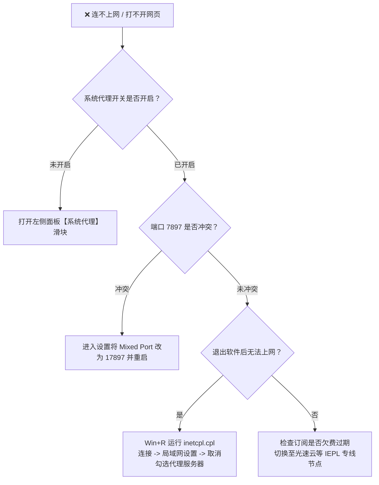
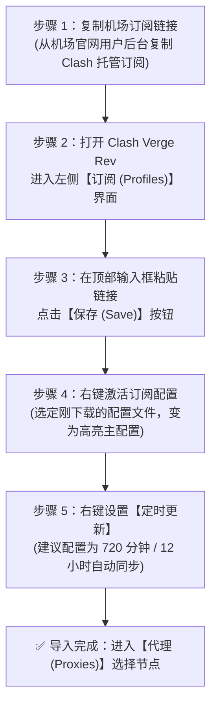

随着 2023 年底原版 Clash 核心及 Clash for Windows（CFW）原作者停止维护，基于新一代 **Mihomo（Clash Meta）内核** 与轻量 **Rust + Tauri 框架** 构建的 **Clash Verge Rev**，已正式成为 2026 年 Windows、macOS 与 Linux 桌面端最受推崇的现代化主力代理工具。

许多刚从旧版 CFW 迁移过来的用户，往往面临诸多操作疑惑：
* 为什么导入订阅后显示“已连接”，浏览器能上网，但 Git 命令行与 VS Code 依然连不上 GitHub？
* 什么是 TUN 模式？为什么有些联机游戏和终端工具必须开启 TUN 才能加速？
* 如何让国内软件（微信、淘宝、百度、B站）完全不走代理，而 Netflix 与 ChatGPT 自动分流到专属低风控节点？
* 为什么有时候关闭软件后，电脑突然无法打开任何网页，连百度也打不开？

本文由 **Flybit 机场测评实验室（flybit.fun）** 技术团队编写，作为全站的**跨平台桌面客户端深度实操教程与排障页（Deep Tutorial Page）**，带你从零基础安装、订阅导入、TUN 虚拟网卡接管、JS 扩展脚本编写到高级分流规则配置，一步到位玩转 Clash Verge Rev。

---

## 零、开篇直接给答案：Clash Verge Rev 连不上网常见故障排查表

### 为什么节点已连接，浏览器却打不开任何网页？

> **Answer Block（核心结论）：**  
> 节点测速显示有延迟（如绿色 35ms），只能证明你的电脑与境外代理服务器之间的 TCP 连通性正常，**并不代表流量已经正确导入本地系统网络栈**。最常见的故障根因是：系统代理开关未开启、本地端口冲突（默认 7897 端口被杀毒软件或残留进程占用），或者 DNS 配置处于污染状态。



### 极速自查四步法：
1. **检查“系统代理（System Proxy）”开关：** 确保客户端左侧面板中的“系统代理”滑块已变为开启高亮状态。
2. **检查本地端口是否冲突：** 打开客户端“设置”，确认 `混合端口（Mixed Port）`（默认通常为 `7897`）未被其他软件占用。若冲突可改为 `17897` 并重启客户端。
3. **切换代理模式：** 将模式从“全局”切回“规则（Rule）”，刷新订阅列表，选择一个绿色的低延迟专线节点（如 [光速云 IEPL 专线](/brands/guangsu)）。
4. **清理历史残留代理：** Windows 用户按 `Win + R` 运行 `inetcpl.cpl`，进入“连接 &rarr; 局域网设置”，取消勾选“为 LAN 使用代理服务器”，然后重新通过 Clash Verge 开启系统代理接管。

---

## 一、为什么 Clash Verge Rev 是现代桌面客户端的终极首选？

相比已经停更甚至存在安全漏洞隐患的老旧客户端，Clash Verge Rev 在架构设计上具备压倒性优势：

| 对比维度 | 旧版 Clash for Windows (CFW) | v2rayN | Clash Verge Rev (最新版) |
| :--- | :--- | :--- | :--- |
| **底层渲染框架** | Electron (体积庞大，内存占用常超 300MB) | .NET / WPF (界面繁琐，跨平台支持差) | **Rust + Tauri (极轻量，内存仅需 40~60MB)** |
| **代理核心内核** | 原版开源 Clash (已停止更新，缺乏新协议) | Xray / V2Ray 核心 | **Mihomo (Clash Meta) 原生内核 (持续高速迭代)** |
| **新协议支持** | 仅支持老旧 SS / VMess，不支持 Reality | 支持较多，但规则分流管理复杂 | **全面支持 VLESS-Reality、Hysteria 2、TUIC v5、SSH** |
| **TUN 虚拟网卡** | 需安装复杂服务，常报虚拟网卡驱动丢失 | 支持较弱，配置门槛极高 | **内置轻量 TUN 引擎，一键免驱托管系统全流量** |
| **域名嗅探 (Sniffer)** | 无或功能简陋 | 支持基础嗅探 | **强大的多协议 TLS/HTTP 流量嗅探与域名重映射** |
| **开源审计状态** | 闭源打包发布，作者已删库注销 | 开源，但仅限 Windows 平台深度优化 | **GitHub 全开源，全球开发者持续审查，安全透明** |

---

## 二、软件官方下载与跨平台安装避坑规范

> **安全红线警示：**  
> 坚决不要在百度搜索前排的非官方推广下载站或任何宣称“破解绿色去广告版”的第三方网盘下载客户端安装包！这些魔改包常被恶意黑产植入后门木马与暗刷流量脚本。必须认准官方开源发布源。

### 2.1 官方下载渠道与芯片架构对照
* **官方 GitHub 仓库：** `https://github.com/clash-verge-rev/clash-verge-rev/releases`
* **安装包架构辨别对照表：**
  * **Windows 64位系统（Intel / AMD）：** 下载 `Clash.Verge_x.x.x_x64-setup.exe`（或免安装便携版 `Clash.Verge_x.x.x_x64_portable.zip`）；
  * **Windows ARM64（高通骁龙芯片笔记本）：** 下载 `Clash.Verge_x.x.x_arm64-setup.exe`；
  * **macOS 苹果芯片（M1 / M2 / M3 / M4 系列）：** 下载 `Clash.Verge_x.x.x_aarch64.dmg`；
  * **macOS Intel 老款芯片：** 下载 `Clash.Verge_x.x.x_x64.dmg`；
  * **Linux 系统：** 提供 `.deb`、`.rpm` 与 `AppImage` 通用便携包。

### 2.2 macOS 系统“已损坏无法打开”一键修复
在 Mac 上安装后若提示“应用程序已损坏，无法打开”，是因为苹果 Gatekeeper 安全机制对未签名包的拦截。打开“终端（Terminal）”，输入以下命令并回车输入密码即可正常打开：
```bash
sudo xattr -r -d com.apple.quarantine /Applications/Clash\ Verge.app
```

---

## 三、订阅导入与全自动更新策略配置全流程



### 3.1 详细导入实操步骤：
1. **获取优质订阅链接：** 登录您信赖的机场后台（如 [光速云](/brands/guangsu) 用户中心），找到“一键导入订阅”或复制“Clash 订阅地址”。
2. **下载并解析配置：** 打开 Clash Verge Rev，点击左侧菜单栏的 **“订阅（Profiles）”**。将刚刚复制的订阅 URL 粘贴到上方输入框内，点击右侧的 **“保存（Save）”** 按钮。客户端会自动拉取远程配置，显示出节点数量与套餐到期时间。
3. **右键激活与定时更新：** 鼠标左键点击该订阅卡片，卡片边框变为高亮主题色，表示已将其设为当前生效配置。随后右键点击该卡片，选择“编辑订阅”，将 **“更新间隔（小时）”** 设为 `12` 或 `24`。这样机场如果紧急更换了被封锁的备用节点，你的客户端每天会自动同步更新，无需手动重复拉取。

---

## 四、代理运行模式深度拆解：规则模式 vs 全局模式 vs 直连模式

客户端左侧导航栏的 **“代理（Proxies）”** 面板顶部，提供了三种运行模式切换：

### 1. 规则模式（Rule）—— 95% 场景下的日常默认选择
* **运作逻辑：** 客户端内置了庞大的路由规则库（基于域名与 IP 归属地）。
* 当你访问百度、淘宝、微信、知乎、Bilibili 等国内服务时，流量直接走本地宽带直连，不消耗机场流量，也不增加任何延迟；
* 当你访问 Google、YouTube、GitHub、Twitter 等境外网站时，流量自动通过代理专线分流出境；
* 当你访问特定流媒体（如 Netflix、Disney+）时，自动触发流媒体专属原生住宅节点策略。

### 2. 全局模式（Global）—— 仅供临时排障与特殊测试
* **运作逻辑：** 强行将电脑所有的网络请求（包括访问国内百度和微信），全部通过你手动选定的单一境外节点转发。
* **适用场景：** 当某个冷门海外小网站在规则模式下打不开、怀疑被规则漏判时，切到全局模式临时查验；日常切勿常驻开启，否则国内软件加载会变慢且白白消耗套餐流量。

### 3. 直连模式（Direct）—— 临时完全脱离代理
* **运作逻辑：** 所有网络流量直接直通本地宽带，等同于关闭代理客户端。适合在玩国服竞技游戏或执行国内大文件高速下载时使用。

---

## 五、核心进阶：TUN 虚拟网卡模式实战（接管系统全流量）

### 5.1 什么是系统代理（System Proxy）的天然局限？
普通“系统代理”仅在 Windows 注册表中设置了一个本地 HTTP/SOCKS 监听端口（如 127.0.0.1:7897）。这种机制存在致命盲区：
* **无法接管终端命令行：** Windows CMD、PowerShell、Git Bash 以及 Linux 终端发起的数据包，默认完全无视系统代理设置，导致 `git clone` 频繁卡死或报 `Connection reset`；
* **无法接管没有代理设置的桌面软件：** 许多跨国联机游戏、Telegram 独立版客户端、Docker 容器以及某些专业开发工具，内部未适配系统代理协议，流量依然走公网裸奔；
* **无法杜绝 UDP 流量阻断：** 网页浏览走 TCP 协议，而语音通话、游戏和流媒体快速缓冲强依赖 UDP，普通系统代理对 UDP 支持欠佳。

### 5.2 TUN 模式底层堆栈（Stack）对比与选型

| TUN 堆栈模式 | 核心工作机制 | CPU 资源消耗 | 吞吐速率表现 | 兼容性与推荐场景 |
| :--- | :--- | :--- | :--- | :--- |
| **System (系统内核栈)** | 依托操作系统内核原生网络栈直接转发处理数据包 | **极低 (占用 CPU 仅 1%~3%)** | **极高 (可轻松跑满 1000M 物理带宽)** | ⭐ **日常主流首选推荐** |
| **gVisor (Go 模拟栈)** | 在 Go 运行时用户态模拟完整 TCP/IP 协议栈 | 较高 (高吞吐下 CPU 负载较重) | 适中 (约 300~500Mbps) | 适合存在特殊驱动冲突时的兼容备选 |
| **Mixed (混合栈)** | TCP 走系统内核，UDP 走用户态快速通道 | 适中 | 高 | 适合特定联机网络游戏加速 |

### 5.3 开启 TUN 模式的实操步骤
**TUN 模式（Virtual Network Interface，虚拟网卡模式）** 会在操作系统网络底层虚拟出一张网卡设备，将整台电脑网卡进出的所有三层 IP 数据包直接捕获并注入 Mihomo 核心，实现真正意义上的 100% 全流量透明接管！

1. **授予管理员权限（Windows 必需）：** 首次开启 TUN 模式前，建议在 Windows 桌面右键以“管理员身份运行”打开 Clash Verge Rev；
2. **安装并激活核心服务模式（Service Mode）：** 
   * 点击客户端左侧 **“设置（Settings）”**；
   * 找到 **“服务模式（Service Mode）”** 选项，点击右侧的“安装（Install）”；
   * 安装成功后，旁边的地球图标会变为亮绿色；
3. **开启 TUN 模式开关：** 
   * 回到设置面板，找到 **“TUN 模式”** 开关并将其开启；
   * 打开 Windows“网络连接”控制面板，你会看到新增了一张名为 `Mihomo` 或 `Clash` 的虚拟网络适配器，此时整台电脑的 Git 命令行、WSL2 子系统、Docker 容器与各类海外游戏均已自动享受低延迟加速！

```bash
# 验证终端命令行是否已成功接管 (PowerShell / Terminal)
curl -i https://ipinfo.io

# 检查当前终端出口 IP，确认已变为海外专线节点 IP
```

---

## 六、进阶生产力：自定义 JavaScript 预处理脚本（Parsers）实战

Clash Verge Rev 允许用户在“订阅”设置中编写自定义 JavaScript 脚本，在拉取机场订阅时自动注入流媒体和 AI 专用策略组，实现千人千面的个性化分流：

```javascript
// 在 Clash Verge Rev 订阅扩展脚本中使用的自动化预处理函数
function main(config) {
  // 1. 定义专属流媒体与 AI 策略组
  const customGroups = [
    {
      name: '🤖 人工智能',
      type: 'select',
      proxies: ['🇺🇸 美国 住宅 IP', '🇯🇵 日本 住宅 IP', 'DIRECT']
    },
    {
      name: '🎬 国际流媒体',
      type: 'select',
      proxies: ['🇭🇰 香港 原生住宅', '🇯🇵 日本 原生住宅', 'DIRECT']
    }
  ];

  // 2. 注入精细化分流规则到规则顶部
  const customRules = [
    'DOMAIN-SUFFIX,openai.com,🤖 人工智能',
    'DOMAIN-SUFFIX,chatgpt.com,🤖 人工智能',
    'DOMAIN-SUFFIX,claude.ai,🤖 人工智能',
    'DOMAIN-SUFFIX,netflix.com,🎬 国际流媒体',
    'DOMAIN-SUFFIX,disneyplus.com,🎬 国际流媒体',
    'GEOIP,CN,DIRECT',
    'MATCH,🚀 节点选择'
  ];

  config['proxy-groups'] = [...customGroups, ...(config['proxy-groups'] || [])];
  config['rules'] = [...customRules, ...(config['rules'] || [])];

  return config;
}
```

详细的流媒体与 AI 住宅 IP 原理解析，可查阅本站的 [《4K 奈飞、Disney+ 与 ChatGPT 5 解锁原理解析与节点选择策略》](/blog/streaming-ai-unlock-guide)。

---

## 七、常见报错与故障排除深度问答（FAQ）

### Q1: 开启 TUN 模式后，为什么电脑突然无法上网，但手机等其他设备正常？
> **答案要点：**  
> 主要是因为虚拟网卡与本地杀毒软件（如 360 安全卫士、火绒网络保护）的底层网络过滤驱动发生了冲突，或者上一次异常关机导致 TUN 路由表未被正常注销。  
> **解决步骤：** 1. 在设置中关闭 TUN 模式，点击服务模式旁边的“卸载”，重启电脑；2. 重新以管理员权限打开客户端安装服务模式并开启 TUN；3. 将客户端的 TUN 堆栈从 `gVisor` 切换为 `System` 重新尝试。

### Q2: 为什么节点测速显示有延时（如绿色 25ms），点击打开网页却报“ERR_CONNECTION_REFUSED”？
> **答案要点：**  
> 这种情况说明机场的国内入口服务器能够连通，但境外落地节点或专线隧道内部发生了故障。请在节点列表中切换到其他区域节点（例如从香港 01 切换至日本 01 或新加坡 01）。若所有节点均无法打开网页，请在订阅界面右键点击“更新订阅”，确认套餐未欠费过期。

### Q3: 为什么关闭 Clash Verge Rev 后，整台电脑都连不上网，连百度也打不开？
> **答案要点：**  
> 这是因为客户端在退出时，未能及时将 Windows 操作系统的“系统代理”注册表项复位为关闭状态，导致系统依然试图将流量转发给已经关闭的本地 7897 端口。  
> **一键修复法：** 按 `Win + S` 搜索“代理服务器设置”，在 Windows 设置窗口中，将“使用代理服务器”开关手动切换为**关**，并点击保存，网络便会瞬间恢复正常。

### Q4: 如何在 Clash Verge Rev 中检查是否存在 DNS 泄漏？
> **答案要点：**  
> 连接节点后，在浏览器访问 `https://dnsleaktest.com`，点击“Standard Test”。如果在测试结果列表中看到了你家宽带运营商（如 China Telecom 或 China Unicom）的 DNS 服务器地址，说明存在严重泄漏。在设置中开启“内置 DNS”并启用 Fake-IP 模式，即可彻底解决此隐患。

### Q5: 为什么在 Clash Verge Rev 中进行延迟测速，部分节点显示 Timeout，但实际能打开网页？
> **答案要点：**  
> 客户端默认采用 Google 204（`http://www.gstatic.com/generate_204`）作为延迟测试 URL。部分节点的出口机房可能拦截了特定的探测特征包，但并没有拦截正常的 HTTPS 网页访问。可以在“设置 &rarr; 测速 URL”中将其修改为 Cloudflare 的轻量测试源 `https://cp.cloudflare.com/generate_204`。

---

## 八、站内核心主题矩阵延伸导读

* 📘 **选购全景指南：** 查阅支柱长文 [《2026 机场选购终极避坑指南：IEPL专线、IPLC与BGP中转有什么区别？》](/blog/airport-buying-guide-2026)。
* 🗂️ **全量品牌筛选库：** 前往 [42家主流机场品牌库](/brands)，挑选适配 Clash Verge 一键导入的优质 IEPL 专线。
* 📸 **晚高峰真实跑分：** 访问 [17家机场测速实验室](/speedtest)，点击查验 PhotoSwipe 5 交互式全屏灯箱。
* 🎬 **流媒体与 AI 分流：** 阅读 [《4K 奈飞、Disney+ 与 ChatGPT 5 解锁原理解析与节点选择策略》](/blog/streaming-ai-unlock-guide)。
* 📱 **苹果手机实战：** 阅读 [《iOS 小火箭（Shadowrocket）美区账号注册与订阅导入指南》](/blog/shadowrocket-ios-guide)。
* 🏡 **全屋软路由透明代理：** 阅读 [《软路由与家庭全屋透明代理搭建：OpenClash vs PassWall 实战对比》](/blog/openclash-vs-passwall-openwrt-guide)。
* ⚖️ **实验室评测准则：** 查阅 [评测准则与实验室方法论白皮书](/about)，了解独立客观的网络工程实测标准。
