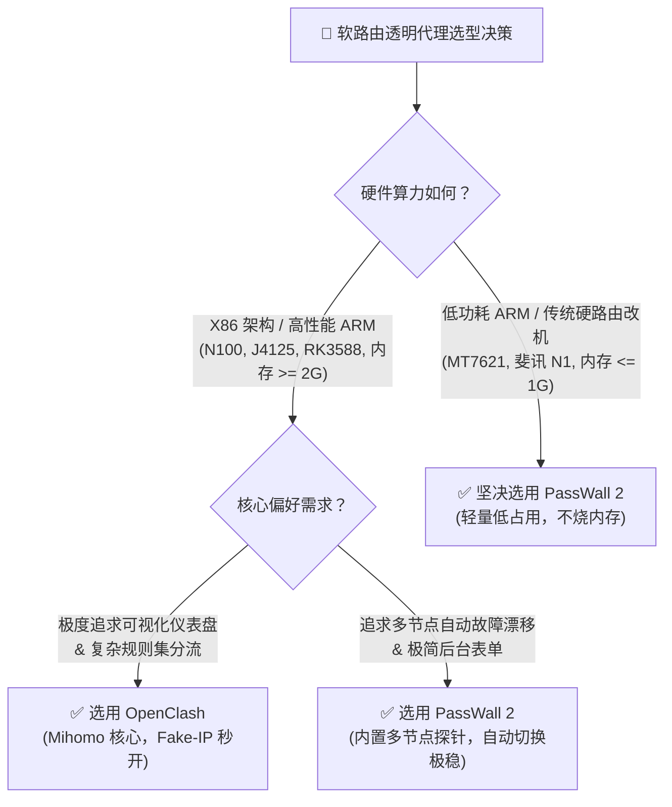
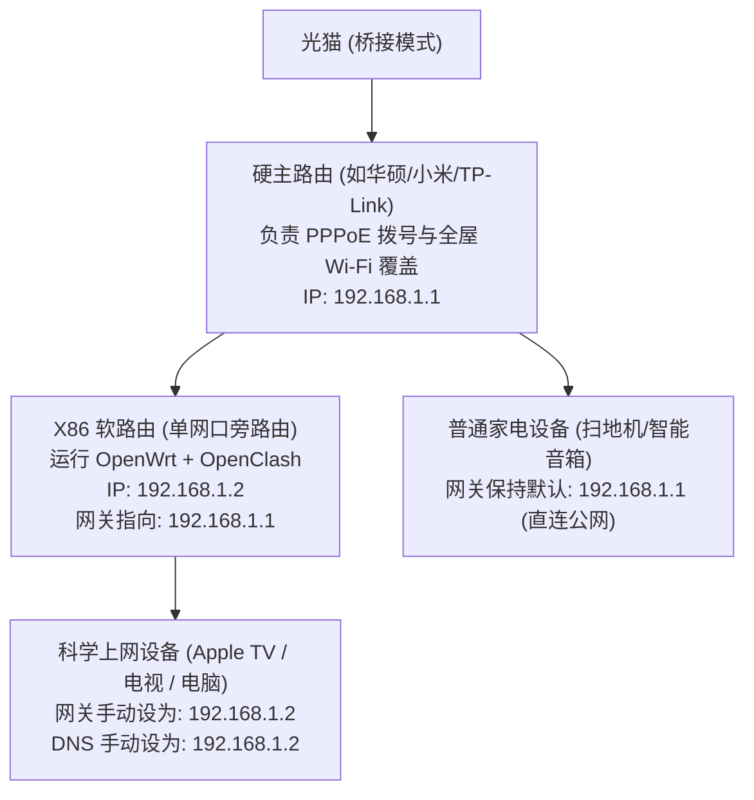

随着家庭中需要科学上网的终端设备日益多样化，手机和电脑端逐一安装代理软件的传统方式逐渐暴露出诸多局限：
* 客厅里的 **Apple TV 4K、索尼智能电视、PS5 游戏机、Nintendo Switch、Xbox** 等设备受限于封闭操作系统，无法直接安装 Clash 或小火箭客户端；
* 家里老人和孩子的手机频繁面临代理软件闪退、误关后台或误开全局模式导致打不开国内淘宝、微信连不上的困扰；
* 多台设备各自运行加密代理客户端，重复消耗本地 CPU 算力与电池电量。

解决这一系列痛点的终极架构方案，便是**在家庭网络中枢部署 OpenWrt 软路由透明网关（Transparent Proxy Gateway）**。所有接入局域网 Wi-Fi 的设备，无需进行任何客户端配置，即可由软路由在 Linux 网络底层自动完成国内外智能分流。

在目前 OpenWrt 生态中，最主流的两大透明代理插件无疑是 **OpenClash** 与 **PassWall 2**。本文由 **Flybit 机场测评实验室（flybit.fun）** 架构团队编写，作为全站的**软路由透明网关架构对比与选型决策核心页（Comparison & Architecture Page）**，全面横评两者的性能差异、内核机制、单臂旁路由拓扑与故障排查全流程。

---

## 零、开篇直接给答案：OpenClash vs PassWall 核心选型决策两句话

### 我究竟该选 OpenClash 还是 PassWall？

> **Answer Block（核心结论）：**  
> * **如果你的软路由 CPU 性能强劲（X86 架构如 Intel N100、N5105、J4125），且追求与电脑端完全一致的精细化规则分流和可视化控制台：** 毫无悬念首选 **OpenClash**。其原生的 Fake-IP (TUN + TProxy) 混合模式能够做到海外 4K 流媒体秒开、DNS 零污染。  
> * **如果你的软路由硬件配置较弱（老旧低功耗 ARM 路由器如 MT7621、斐讯 N1），或者网络拓扑复杂、需要多节点自动分流负载均衡与备用节点秒级故障转移（Failover）：** 强烈建议选择 **PassWall 2**。其采用轻量系统服务架构，CPU 与内存消耗仅为 OpenClash 的三分之一。



---

## 一、为什么极客家庭必须搭建软路由透明网关？

| 普通单机安装客户端方案 | 软路由全屋透明网关方案 |
| :--- | :--- |
| 每台手机、电脑、平板都需要单独购买安装软件，配置复杂 | **全屋设备连上 Wi-Fi 自动生效，零客户端免配置** |
| Apple TV、PS5、Switch、扫地机器人等设备无法使用代理 | **封闭系统设备自动享受海外流媒体与联机游戏加速** |
| 手机后台频繁被系统杀进程，导致代理断连、消息漏接 | **网络中枢 24 小时常驻运行，稳定不断线** |
| 各设备独立发起连接，重复消耗本地 CPU 与电池电量 | **加解密计算全由路由器硬件承担，移动设备更省电** |

---

## 二、两大核心插件全维度横向技术对比大表

| 评测维度 | OpenClash | PassWall 2 (PassWall 最新版) |
| :--- | :--- | :--- |
| **底层代理核心** | **Mihomo (Clash Meta) 原生内核** | Xray / V2Ray / Sing-box / Trojan-Go 多核心可选 |
| **CPU 与内存资源消耗** | 较高 (常驻消耗 150MB~300MB 内存，高并发吞吐对 CPU 压力大) | **极低 (通常仅需 30MB~60MB 内存，极度适合低功耗设备)** |
| **DNS 处理模式** | **Fake-IP (TUN+TProxy) 混合模式极其强大，秒开率极高** | 采用 Chinadns-NG / Dnsmasq 进行国内国外分流，配置稍繁琐 |
| **规则分流精细度** | **极致精细 (完整支持 RULE-SET、GEOIP、GEOSITE 规则集)** | 依托 GFWList、大陆白名单与自定义黑白名单，规则较固定 |
| **多节点自动故障转移** | 支持 Fallback 策略组，但切换逻辑依赖配置文件 | **内置强大的自动故障切换探针，主节点异常自动秒级漂移** |
| **后台控制台 UI 体验** | **内置 Yacd / Metacubexd 现代化网页仪表盘，极其美观** | 传统的 LuCI 纯表单设置界面，偏向工程配置 |
| **IPv6 双栈透明支持** | 支持，可精细配置 IPv6 Fake-IP 过滤 | 支持，但配置不当易引起 DNS 泄漏 |

---

## 三、底层网络转发机制剖析：Fake-IP vs Redir-Host vs TProxy

在 OpenWrt Linux 内核层面，透明网关的数据包截获通常依托 `iptables` 或现代 `nftables`：

### 1. Fake-IP 混合模式（首选推荐）
* **原理解析：** 当局域网设备发起 DNS 解析时，软路由内核直接在本地内存映射并返回一个保留的内网虚拟 IP（如 `198.18.0.1/16`）。设备拿到虚拟 IP 后立刻发起 TCP 握手，软路由直接将域名和真实流量打包进加密隧道，交由境外专线节点在当地干净解析。
* **核心优势：** 完全消除了等待海外 DNS 解析的往返时间（RTT），**视频首帧加载与网页打开呈现“零延迟秒开”**；彻底阻断国内运营商本地 DNS 污染。

### 2. Redir-Host 兼容模式
* **原理解析：** 软路由必须先将域名发送给上游真实 DNS 服务器解析出真实海外 IP，再将流量转发给代理。
* **缺点：** 容易受到国内 DNS 污染，且每次访问新网址都会产生额外的解析耗时，不建议在 2026 年作为主力使用。

### 3. TProxy 透明代理模式（对比传统 REDIRECT）
* **REDIRECT 的局限：** 仅能处理 TCP 流量，并且在 NAT 表中会强制重写目标 IP 为 127.0.0.1，破坏了原始数据包的目的地址；
* **TProxy 的优势：** 依托 Linux 内核的 `socket` 匹配与 `ip rule` 策略路由，能够保留原始数据包的四元组元数据，并且完美原生支持 UDP 流量透明代理，是解决主机游戏（PS5 / Switch）NAT-Type 开放与电视端语音通话的最佳底层支撑。

---

## 四、旁路由（单臂网关）拓扑 vs 双网口主路由实战指南

对于大多数家庭用户而言，为了避免折腾软路由导致全家断网被家人抱怨，**“硬路由负责拨号、软路由作为单臂旁路网关”**是容错率最高的黄金拓扑：



### 4.1 旁路由核心网络参数配置（避坑关键）
1. **静态 IP 设置：** 软路由 LAN 口 IP 设为主路由同网段的不冲突静态地址（如主路由是 `192.168.1.1`，软路由设为 `192.168.1.2`）；
2. **网关与 DNS 指向：** 软路由的“网关（IPv4 Gateway）”与“DNS 服务器”必须严格填写主路由 IP（`192.168.1.1`）；
3. **关闭软路由 DHCP 服务：** 必须在软路由 LAN 口设置中勾选 **“忽略此接口（不在此接口提供 DHCP 服务）”**，由主路由统一分配 IP 地址，彻底避免局域网内存在双 DHCP 导致 IP 冲突瘫痪；
4. **需要出海的终端配置：** 将 Apple TV、PS5 或自己电脑的 IPv4 设置从“自动”改为“手动”，IP 保持不变，**将“网关”与“DNS”均修改为软路由 IP（`192.168.1.2`）**。

### 4.2 彻底根除“旁路由单向断流”的 iptables 防火墙关键规则
在单臂旁路由拓扑中，设备向旁路由发送请求，主路由在回包时却直接将数据包发回给设备，导致设备收到非对称路由响应而主动 Reset 连接。必须在 OpenWrt“网络 &rarr; 防火墙 &rarr; 自定义规则”中追加以下规则：

```bash
# 单网口旁路由 NAT 环回修复规则 (eth0 请替换为实际 LAN 口物理网卡名)
iptables -t nat -I POSTROUTING -o eth0 -j MASQUERADE

# 强制重定向局域网内所有未受控的 53 端口 DNS 请求到本地核心
iptables -t nat -A PREROUTING -p udp --dport 53 -j REDIRECT --to-ports 53
iptables -t nat -A PREROUTING -p tcp --dport 53 -j REDIRECT --to-ports 53
```

---

## 五、硬件选型与算力瓶颈深度横评

软路由的加解密吞吐直接取决于 CPU 的架构与指令集支持：

| 处理器型号 | 核心规格与工艺 | 硬件加解密支持 | 物理千兆满载吞吐表现 | 适合场景 |
| :--- | :--- | :--- | :--- | :--- |
| **联发科 MT7621 (硬路由改机)** | 双核四线程 MIPS 880MHz | 缺乏 AES 硬件指令集 | 代理吞吐被锁死在 80~120Mbps | 极低预算，仅限轻度文字网页 |
| **晶晨 Amlogic S905D (斐讯 N1)** | 四核 Cortex-A53 1.5GHz | 支持 ARMv8 Crypto 指令 | 代理吞吐约 250~350Mbps | 入门级旁路由，适合 200M 宽带 |
| **Intel Celeron J4125** | 四核 2.0~2.7GHz X86 | **完整支持 AES-NI 指令集** | 代理下行稳定跑满 600~800Mbps | 高性价比经典款，家用千兆主流 |
| **Intel Processor N100 / N5105** | 四核 Intel 7 工艺 3.4GHz | **集成最新 AES-NI + AVX2** | **晚高峰轻松跑满 1000M 物理线速** | 极客全能首选，兼顾 Docker 与 NAS |

* **关键设置技巧：** 在 OpenWrt“网络 &rarr; Turbo ACC 网络加速”设置中，务必开启 **“软件流量分载（Software Flow Offloading）”** 与 **“BBR 拥塞控制”**，可降低 CPU 占用 50% 以上。

---

## 六、常见软路由报错与故障排除深度问答（FAQ）

### Q1: 旁路由配置完成后，电脑国内网站能打开，但打不开 Google 和 YouTube？
> **答案要点：**  
> 这是旁路由经典的**“防火墙数据流单向阻断”**问题。主路由向电脑发送的数据包没有经过旁路由处理，导致连接发生非对称路由。  
> **一键修复法：** 在 OpenWrt 终端中运行以下命令，或在“网络 &rarr; 防火墙 &rarr; 自定义规则”底部追加一行代码并重启防火墙：  
> `iptables -t nat -I POSTROUTING -o eth0 -j MASQUERADE`

### Q2: 为什么在软路由上配置后，微信经常发不出图片或朋友圈加载缓慢？
> **答案要点：**  
> 主要是因为 Fake-IP 模式将微信国内 CDN 域名的 DNS 请求强行代理，或者发生了 TCP MSS 数据包分片。在 OpenClash 规则设置中，将 `DOMAIN-SUFFIX,qpic.cn`、`DOMAIN-SUFFIX,weixin.qq.com` 显式设为 `DIRECT` 直连；并在“网络加速”中开启 MSS 钳制（MSS Clamping）。

### Q3: 为什么 Apple TV 电视端打开 Netflix 依然提示“检测到代理”？
> **答案要点：**  
> Apple TV 会在后台向 Google 的公共 DNS（`8.8.8.8` / `8.8.4.4`）强行发起硬编码查询。如果软路由没有强制拦截 53 端口，Apple TV 会直接绕过软路由的 Fake-IP。在 OpenClash 设置中勾选 **“强制拦截所有 DNS 请求（Redirect 53 Port）”**，即可彻底堵死此漏洞。详细流媒体住宅 IP 原理可参考 [《4K 奈飞、Disney+ 与 ChatGPT 5 解锁原理解析与节点选择策略》](/blog/streaming-ai-unlock-guide)。

### Q4: 软路由上如何为 PS5 / Switch 联机游戏优化 NAT 类型（NAT Type A）？
> **答案要点：**  
> 联机游戏出现 NAT Type 3（Strict）会导致无法联机或进房间困难。解决步骤：1. 在 OpenWrt 中开启 UPnP 自动端口映射服务；2. 在 OpenClash 模式设置中开启 FullCone NAT 模式；3. 将游戏主机 IP 在分流规则中加入 Direct 直连，或绑定专门针对游戏优化的低丢包 IEPL 节点（如 [光速云 IEPL 节点](/brands/guangsu)）。

### Q5: 为什么软路由测速下行带宽能跑满千兆，但手机测速只有 200M？
> **答案要点：**  
> 这通常是 Wi-Fi 路由器频宽设置或无线回程瓶颈所致。确保手机连接的是 5GHz 频段且频宽设置为 80MHz 或 160MHz；若采用 Mesh 组网，无线回程衰减会导致带宽砍半。排除 Wi-Fi 干扰后，请查阅 [17家机场测速实验室](/speedtest) 确认节点本身的单线程物理承载能力。

---

## 七、站内核心主题矩阵延伸导读

* 📘 **选购全景指南：** 查阅支柱长文 [《2026 机场选购终极避坑指南：IEPL专线、IPLC与BGP中转有什么区别？》](/blog/airport-buying-guide-2026)。
* 🗂️ **全量品牌筛选库：** 前往 [42家主流机场品牌库](/brands)，挑选适配 OpenClash 一键导入的优质 IEPL 专线。
* 📸 **晚高峰真实跑分：** 访问 [17家机场测速实验室](/speedtest)，点击查验 PhotoSwipe 5 交互式全屏灯箱。
* 💻 **电脑客户端上手：** 阅读 [《Clash Verge Rev 完整上手实操：Mihomo 内核与 TUN 虚拟网卡教程》](/blog/clash-verge-rev-tutorial)。
* 📱 **苹果手机实战：** 阅读 [《iOS 小火箭（Shadowrocket）美区账号注册与订阅导入指南》](/blog/shadowrocket-ios-guide)。
* 🎬 **流媒体与 AI 解锁：** 阅读 [《4K 奈飞、Disney+ 与 ChatGPT 5 解锁原理解析与节点选择策略》](/blog/streaming-ai-unlock-guide)。
* ⚖️ **实验室评测准则：** 查阅 [评测准则与实验室方法论白皮书](/about)，了解独立客观的网络工程实测标准。
