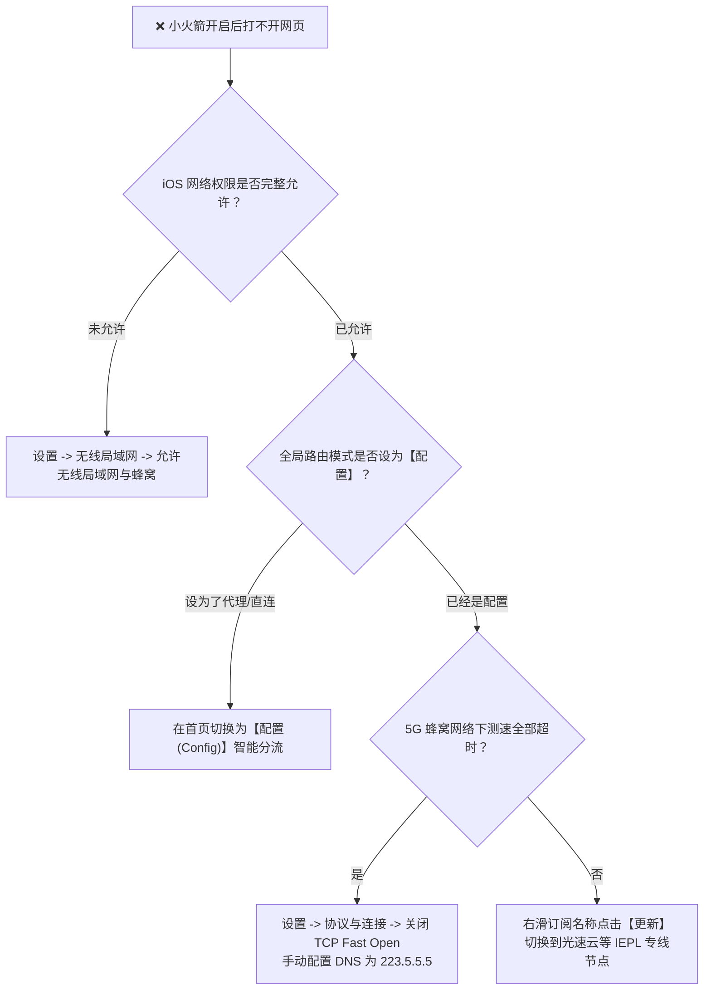
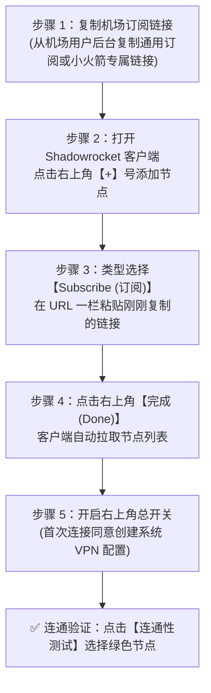

对于使用苹果 iPhone 与 iPad 的 iOS 用户而言，**Shadowrocket（俗称“小火箭”）** 无疑是整个移动生态中知名度最高、协议支持最全面、稳定性最出色的专业网络代理工具。

然而，由于 App Store 中国大陆区政策限制，小火箭并未在国区上架。许多苹果新手在初次尝试时常常面临一系列门槛：
* 为什么国区 App Store 搜索“小火箭”全是山寨扣费软件？如何安全获取正版？
* 没有海外信用卡，如何注册美区 Apple ID 并安全购买 2.99 美元正版？
* 导入订阅后，为什么连接成功却经常提示“延迟测试超时”？为什么微信收不到消息？
* 如何通过 iPhone 热点将科学上网网络共享给没有安装代理的 iPad 或 Switch 游戏机？

本文由 **Flybit 机场测评实验室（flybit.fun）** 技术团队编写，作为全站的**苹果 iOS 移动端核心实战教程与排障页（Deep Tutorial & Troubleshooting Page）**，带你从美区账号准备、礼品卡充值、订阅一键导入、规则分流、HTTPS 证书解密到热点共享，全面攻克 iOS 科学上网。

---

## 零、开篇直接给答案：Shadowrocket 无法联网极速排查表

### 为什么小火箭连接成功，顶部有 VPN 图标，却打不开网页？

> **Answer Block（核心结论）：**  
> 顶部出现 VPN 标志仅代表 iOS 系统的虚拟隧道接口已建立，并不代表境外专线链路已跑通。最常见的故障根因是：**首次安装未授予本地网络或无线局域网权限、误开启了“代理（全局）”模式把国内流量阻断、蜂窝移动网络对 UDP 协议进行了 QoS 丢包限制，或者机场订阅链接欠费过期**。

### 极速自查四步法：
1. **检查 iOS 网络权限：** 打开 iPhone“设置 &rarr; 无线局域网 &rarr; 使用无线局域网与蜂窝网络的 App”，找到 Shadowrocket，确保其权限设置为“无线局域网与蜂窝网络”。
2. **确认全局路由模式：** 打开小火箭首页，在第一栏找到“全局路由”，确保其设置为 **“配置（Config）”**，千万不要误设为“代理（Proxy）”或“直连（Direct）”。
3. **批量测试节点真机延迟：** 在小火箭首页点击“连通性测试”。选择一个显示绿色毫秒数字（如 25ms~45ms）的优质专线节点（如 [光速云 IEPL 节点](/brands/guangsu)）。
4. **更新订阅重置节点：** 右滑你的订阅名称，点击“更新”，重新同步机场最新的入口服务器 IP。

---

## 一、为什么 Shadowrocket 是 iOS 平台的首选工具？

在苹果生态中，虽然还有 Loon、Quantumult X、Surge 与 Stash 等优秀工具，但对于 90% 的普通用户而言，Shadowrocket 依然是绝对的无脑首选：

| 对比维度 | Shadowrocket (小火箭) | Quantumult X (圈 X) | Surge iOS |
| :--- | :--- | :--- | :--- |
| **应用买断售价** | **$2.99 美元 (约合 ¥21 元，一次买断终身使用)** | $7.99 美元 (约合 ¥58 元) | $49.99 美元起 (按年订阅，极其昂贵) |
| **协议兼容生态** | **几乎全协议通吃 (SS/VMess/VLESS/Reality/Hysteria2/Trojan)** | 偏向传统协议，对新协议跟进较慢 | 商业级体验，但部分小众协议不支持 |
| **新手上手门槛** | **极低 (支持一键导入与二维码扫码，开箱即用)** | 中等 (需要手动配置策略组与分流脚本) | 高 (偏向专业网络工程师抓包与诊断) |
| **热点共享能力** | **支持代理共享，将 iPhone 变成便携透明网关** | 需配合额外脚本 | 支持，但配置较复杂 |
| **规则与分流** | **内置自动远程规则集更新，支持按域名/IP分流** | 依靠强大 JavaScript 脚本重写 | 顶级的模块化与规则引擎 |

---

## 二、免海外信用卡注册美区 Apple ID 与购买正版小火箭全流程

> **安全红线警示：**  
> 坚决不要在国区 App Store 搜索所谓“小火箭加速器”！App Store 里面充斥着大量套皮山寨恶意扣费软件（图标类似但会每周自动扣款几十元）。正版开发者为 **Pan Guan**，售价为 **$2.99 美元**。同时严禁购买网上公开发布的共享 Apple ID，极易导致个人手机在“查找我的 iPhone”中被恶意远程锁机勒索！

### 2.1 如何免海外信用卡注册全新美区 Apple ID？
1. **浏览器无痕模式打开官网：** 在电脑或手机 Safari 打开苹果官方注册入口：`https://appleid.apple.com`；
2. **填写注册基础资料：** 国家或地区务必选择 **“美国（United States）”**，邮箱填写从未注册过苹果账号的全新邮箱（推荐 Gmail 或 Outlook），手机号可直接填写中国大陆手机号（仅用于接收短信验证码）；
3. **完成双重验证：** 提交后输入邮箱验证码和手机短信验证码，账号即完成初步注册；
4. **App Store 登录与免税州地址填写：**
   * 打开 iPhone 上的 **App Store**，点击右上角头像滚动到底部，点击 **“退出登录”** 原有账号；
   * 登录刚刚注册的美区账号，系统会弹出“此 Apple ID 尚未在 iTunes Store 使用过，请检查”，点击“检查”；
   * 付款方式务必选择 **“无（None）”**；
   * **账单地址（Billing Address）免税州模板：**  
     为了避免购买软件时被额外征收 8%~10% 的消费税，建议选择美国五大免税州之一（如俄勒冈州 Oregon）：
     * **街道（Street）：** 1200 SW 5th Ave
     * **城市（City）：** Portland
     * **州（State）：** OR - Oregon
     * **邮编（Zip Code）：** 97204
     * **电话号码（Phone）：** 503 222-1234
   * 点击下一步，账号即可顺利完成激活！

### 2.2 如何给美区账号充值 $2.99 美元？
* **渠道一：苹果官方网站购买数字礼品卡（首选推荐）**  
  在苹果美区官网 `apple.com/shop/buy-giftcard/giftcard` 使用国内双币信用卡（Visa / MasterCard）购买一张 $10 美元的电子礼品卡，充值码会直接发送到你的邮箱；
* **渠道二：支付宝购买正规礼品卡**  
  打开支付宝 APP，将左上角地区切换至“旧金山”，在首页点击“大牌礼品卡”搜索“App Store 礼品卡”，按需购买 $3~$5 美元充值码；
* 收到 16 位兑换码后，在 App Store 点击右上角头像，选择 **“Redeem Gift Card or Code（兑换充值卡或代码）”**，成功充值后搜索 `Shadowrocket` 即可直接购买下载！

---

## 三、机场订阅一键导入与扫码配置实操步骤

### 3.1 详细导入实操要点：
1. **一键唤起导入（最便捷）：** 在手机 Safari 浏览器登录机场后台（如 [光速云](/brands/guangsu)），找到“便捷导入 &rarr; 一键导入 Shadowrocket”。点击后系统会自动唤起小火箭并完成全部节点拉取。
2. **手动链接导入：** 打开小火箭，点击右上角 **“+”** 号。在“类型”下拉菜单中选择第三项 **“Subscribe（订阅）”**。在“URL”框内粘贴机场订阅链接，备注写上机场名称，点击右上角“完成”。
3. **开启自动更新订阅：** 点击小火箭底部菜单栏的 **“设置” &rarr; “订阅”**，开启 **“打开时更新”** 与 **“自动后台更新”**。这样每次打开小火箭，它都会在后台自动同步最新的备用专线节点。

---

## 四、全局路由模式深度解析：配置 vs 代理 vs 直连

在小火箭首页正中央，有一项名为 **“全局路由（Global Routing）”** 的核心控制选项：

### 1. 配置（Config）—— 强烈推荐常驻使用
* **工作机制：** 依托小火箭底部的“配置”规则集进行智能分流。
* 访问微信、淘宝、美团、百度、网易云音乐走本地直连，不消耗机场流量；
* 访问 Google、YouTube、Twitter、GitHub 走海外专线；
* 访问 Netflix 与 ChatGPT 自动路由到具备原生住宅解锁的专属节点。

### 2. 代理（Proxy）—— 仅供排障临时使用
* **工作机制：** 强行把手机所有的联网流量（包括国内 APP），全部无差别打给当前选中的节点。
* 会导致国内应用打开变慢、微信收到异地登录提醒，且严重浪费套餐流量。

### 3. 直连（Direct）
* 所有流量均不经过代理，等同于关闭小火箭。

---

## 五、进阶核心技巧：HTTPS 证书解密与代理热点共享

### 5.1 开启 MitM（HTTPS 解密）证书信任
若要让小火箭执行深度的 URL 重写、广告拦截或流媒体伪装，必须在 iOS 系统中安装并信任根证书：
1. 打开小火箭底部 **“配置”**，点击当前正在使用的规则文件右侧的叹号图标；
2. 找到 **“HTTPS 解密（MitM）”**，将其开启；
3. 点击 **“生成新的 CA 证书”**，随后点击“安装证书到系统”；
4. 进入 iPhone“设置 &rarr; 通用 &rarr; 关于本机 &rarr; 证书信任设置”，在底部找到刚刚安装的 `Shadowrocket` 根证书，将其后面的开关切换为**开启信任**状态。

### 5.2 开启“代理共享”将 iPhone 变为便携透明网关
当出门在外没有软路由时，可以通过小火箭将手机代理共享给随身的 Switch 或电脑：
1. 打开小火箭“设置 &rarr; 代理共享”；
2. 开启 **“启用共享”** 开关，界面会显示一个本地 IP（如 `172.20.10.1`）与端口 `1082`；
3. 打开 iPhone 个人热点；
4. 将你的 Nintendo Switch 或笔记本连上该热点，在 Wi-Fi 高级设置中配置 HTTP 代理，IP 填写 `172.20.10.1`，端口填写 `1082`，即可实现全设备加速！详细软路由家庭对比可参考 [《软路由 OpenClash vs PassWall 实战对比指南》](/blog/openclash-vs-passwall-openwrt-guide)。

---

## 六、常见 iOS 报错与故障排除深度问答（FAQ）

### Q1: 节点测速全部显示“超时”或“-1ms”，但换到 Wi-Fi 下又正常了？
> **答案要点：**  
> 这是典型的蜂窝移动网络限制问题。国内部分省份运营商的 4G/5G 基带会对特定境外端口进行 UDP 拦截。进入小火箭“设置 &rarr; 协议与连接”，将 TCP 快速打开（TCP Fast Open）关闭；或者在小火箭设置中将 DNS 服务器手动指定为 `223.5.5.5` 与 `1.1.1.1`，重新测试即可恢复。

### Q2: 开启小火箭后，为什么微信、钉钉收不到即时消息推送，必须点进 APP 才能刷新？
> **答案要点：**  
> 主要是因为全局路由误设为了“代理（Proxy）”，导致苹果 APNs（Apple Push Notification service）推送通道被代理节点切断。将全局路由模式切回 **“配置（Config）”**，并在配置规则中确保 `DOMAIN-SUFFIX,push.apple.com` 与 `apple.com` 处于 DIRECT 直连状态。

### Q3: 为什么看 TikTok 视频总是显示“黑屏”或“无网络连接”？
> **答案要点：**  
> TikTok 官方针对插有中国大陆 SIM 卡的 iPhone 做了硬件级封锁。解决方案通常有两种：1. 拔掉 SIM 卡或使用无卡备用机连接 Wi-Fi 使用；2. 在小火箭中配置 MitM 证书解密并开启 URL 重写模块（Rewrite），将请求头中的运营商 MNC 代码替换为海外代码。

### Q4: 换了新 iPhone，如何在新手机上免重新购买直接下载小火箭？
> **答案要点：**  
> 在新手机上打开 App Store，退出当前的国区账号，登录当年购买过小火箭的**同一个美区 Apple ID**。点击右上角头像进入“已购项目（Purchased）”，找到 Shadowrocket 直接点击云朵图标下载即可，完全不需要重复支付 $2.99 美元。

### Q5: 小火箭常驻后台是否会导致 iPhone 电池耗电加剧？
> **答案要点：**  
> 不会明显增加耗电。小火箭采用的是标准的 iOS Network Extension 框架，仅在有网络请求时唤醒数据包转发逻辑。如果发现后台耗电异常，通常是因为开启了“代理共享”或在弱网环境下开启了过高频次的自动延迟探测。建议在“设置 &rarr; 连通性测试”中关闭自动循环测速。

---

## 七、站内核心主题矩阵延伸导读

* 📘 **选购全景指南：** 查阅支柱长文 [《2026 机场选购终极避坑指南：IEPL专线、IPLC与BGP中转有什么区别？》](/blog/airport-buying-guide-2026)。
* 🗂️ **全量品牌筛选库：** 前往 [42家主流机场品牌库](/brands)，挑选适配 Shadowrocket 一键导入的优质 IEPL 专线。
* 📸 **晚高峰真实跑分：** 访问 [17家机场测速实验室](/speedtest)，点击查验 PhotoSwipe 5 交互式全屏灯箱。
* 💻 **电脑客户端上手：** 阅读 [《Clash Verge Rev 完整上手实操：Mihomo 内核与 TUN 虚拟网卡教程》](/blog/clash-verge-rev-tutorial)。
* 🎬 **流媒体与 AI 解锁：** 阅读 [《4K 奈飞、Disney+ 与 ChatGPT 5 解锁原理解析与节点选择策略》](/blog/streaming-ai-unlock-guide)。
* 🏡 **全屋软路由透明代理：** 阅读 [《软路由与家庭全屋透明代理搭建：OpenClash vs PassWall 实战对比》](/blog/openclash-vs-passwall-openwrt-guide)。
* ⚖️ **实验室评测准则：** 查阅 [评测准则与实验室方法论白皮书](/about)，了解独立客观的网络工程实测标准。
