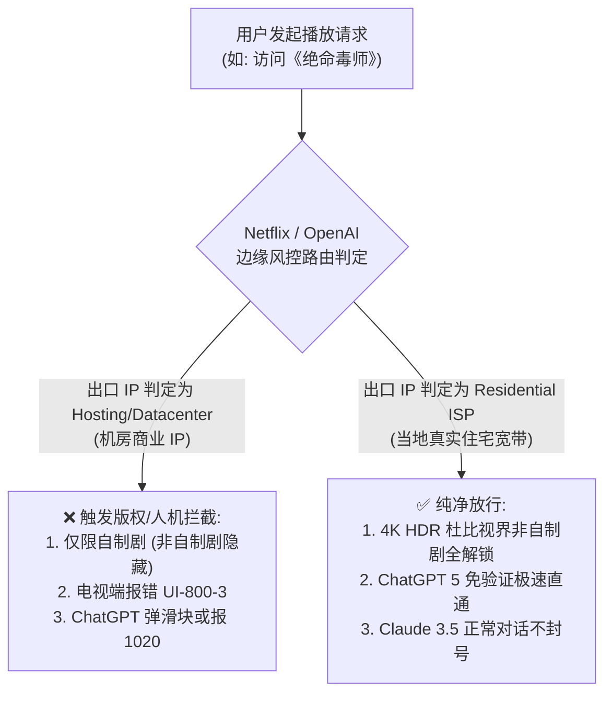

随着海外流媒体平台（如 Netflix、Disney+、HBO Max、YouTube Premium）以及前沿生成式 AI 工具（如 OpenAI ChatGPT 5、Anthropic Claude 3.5、Google Gemini Advanced）对中国大陆 IP 审查风控算法的持续升级，“解锁”已经从过去简单的“挂个代理就能用”，演变为一场极其精密的技术攻防对抗。

许多用户在购买节点后常常遇到以下典型困惑：
* 为什么同一个节点，网页端能登录 Netflix，但在 Apple TV 或索尼电视上点击播放就黑屏报错？
* 为什么能看《怪奇物语》，却搜不到特定地区的《绝命毒师》或《名侦探柯南》？
* 为什么打开 ChatGPT 频繁弹出极其繁琐的人机验证滑块，甚至突然遭遇 `Access Denied 1020` 拒绝访问？
* 为什么访问 Claude 3.5 总是提示“App unavailable in your country”，即便已经开启了全局代理？

本文由 **Flybit 机场测评实验室（flybit.fun）** 网络架构团队编写，作为全站的**流媒体与前沿 AI 解锁专题集群核心页（Topic Cluster Page）**，全面解析原生住宅 IP、SNI 劫持与 SmartDNS、DRM 硬件密钥、TLS 指纹识别与客户端精细分流规则配置全流程。

---

## 零、开篇直接给答案：流媒体与 AI 解锁自查三步法与核心结论

### 为什么有些节点能看网页版奈飞，却播放不了非自制剧？

> **Answer Block（核心结论）：**  
> 因为 Netflix 对自制剧（Netflix Originals）与非自制剧（Licensed Content）实施了**分级版权隔离**。自制剧拥有全球独家版权，放行商业机房 IP；而非自制剧受地区版权法严苛限制，一旦检测到出口 IP 属于商业托管数据中心（Hosting/Data Center IP），前端会直接隐藏非自制剧或弹出代理拦截警告。只有配置了真实**原生家庭住宅宽带 IP（Residential ISP IP）**的节点，才能实现 100% 完整解锁。



### 流媒体与 AI 解锁自查三步法：
1. **核验出口 IP 属性：** 访问 `https://ipinfo.io`，查看当前代理出口的 `company type`。若显示为 `hosting`，说明属于容易被封锁的数据中心机房 IP；若显示为 `isp`，说明属于当地电信运营商分配的纯净原生住宅 IP。
2. **排查 DNS 泄漏隐患：** 访问 `https://browserleaks.com/dns`，确保列表中不出现任何中国大陆运营商（如 China Telecom / Unicom）的解析服务器地址。
3. **配置客户端独立分流：** 绝不要使用单一全局节点处理所有流量。必须在客户端中将流媒体、AI 工具与日常浏览拆分为独立规则集（Rule Provider），让流媒体走原生住宅解锁节点，日常办公走低延迟物理专线。

---

## 一、Netflix（奈飞）版权分级壁垒、OCA 缓存与 Widevine DRM 机制

### 1.1 自制剧版权池与非自制剧版权池的本质鸿沟

| 版权分类 | 代表剧集举例 | 平台风控审查策略 | 常见机房 IP 表现 | 实验室推荐标准 |
| :--- | :--- | :--- | :--- | :--- |
| **自制剧版权池 (Netflix Originals)** | 《怪奇物语》《鱿鱼游戏》《黑镜》《后翼弃兵》 | 全球独家全版权，风控极度宽松 | 几乎所有普通机房节点均可顺畅播放 | 仅代表基础可用，不属于全解锁 (C级) |
| **非自制剧版权池 (Licensed Content)** | 《绝命毒师》《名侦探柯南》《进击的巨人》《哈利·波特》 | 受地区独家发行合约约束，风控极严 | 页面直接隐藏剧集，或提示“正在使用解除封锁器” | ⭐ 必须支持播放目标地区非自制剧 (A+级) |

### 1.2 Netflix 官方 CDN 架构：Open Connect Appliance（OCA）边缘缓存机理

Netflix 为了在全球范围内分发 4K 乃至 8K 超高清视频流，建立了自己的专用 CDN 体系——**Open Connect**：
* Netflix 将专门定制的硬件存储服务器（被称为 **OCA，Open Connect Appliance**）直接免费部署在各大跨国电信运营商（如香港 HKT、台湾中华电信、日本 NTT、美国 Comcast）的核心交换中心机房内部；
* 当用户发起播放请求时，Netflix 调度系统会根据用户出口 IP 的 ASN（自治系统号）与物理地理位置，自动将视频数据流重定向到离用户最近的 OCA 边缘服务器；
* 如果用户的代理节点出口是一个廉价的欧洲机房 IP，即便在网页端被伪装成了美区，Netflix 的 OCA 调度中心也会发现视频数据流请求来自异常的自治系统，从而强制切断 4K 高码率传输管道，导致画质被限制在模糊的 480P 或 720P。

### 1.3 Widevine 数字版权管理（DRM）安全等级划分

很多人不知道，即使你的节点支持 4K 解锁，在电脑浏览器端也常常无法播放 4K 规格，这背后的核心原因是 **Google Widevine DRM（数字版权管理）安全等级**：

| Widevine DRM 等级 | 硬件与加密实现架构 | 支持最高视频分辨率 | 典型支持硬件设备 |
| :--- | :--- | :--- | :--- |
| **Widevine L1 (最高安全级)** | 所有加密与视频解码均在芯片硬件可信执行环境（TEE）中完成 | **4K Ultra HD (2160p) + 杜比视界 (Dolby Vision) + HDR10** | Apple TV 4K、Chromecast with Google TV、索尼/三星智能电视、iPad Pro、通过认证的旗舰手机 |
| **Widevine L2 (中间安全级)** | 仅密码学计算在硬件中完成，视频处理在软件中执行 | 1080p Full HD | 部分平板与电视盒子 |
| **Widevine L3 (软件纯纯级别)** | 完全在操作系统用户态纯软件模拟解码，无硬件保护 | **仅限 720p 甚至 540p 标清画质** | Windows / macOS 上的 Chrome、Firefox、Edge 浏览器（未装 HEVC 解码插件） |

* **发烧友实操建议：** 如果想在电视或大屏显示器上享受纯正 4K 杜比视界高码率体验，必须使用经过 Widevine L1 硬件认证的终端（如 Apple TV 4K），配合本站推荐的支持家庭全屋透明代理的 [软路由透明网关方案](/blog/openclash-vs-passwall-openwrt-guide)。

### 1.4 电视端 APP 的 ESN 硬件码检测机制

在 Apple TV 4K、Google Chromecast 以及索尼 Android TV 上运行 Netflix 官方客户端时，APP 会强制读取电视芯片底层的 **ESN（Electronic Serial Number）硬件识别码**。
* 廉价机场常用的“DNS 解锁劫持（SmartDNS）”仅在电脑浏览器端起效；
* 当电视端 APP 发现发送请求的设备是正规大屏电视硬件，而网络传输却存在 DNS 转发反常时，会瞬间触发最高安全级别的反作弊风控，直接弹出 `UI-800-3` 或 `NW-2-5` 错误代码并拒绝登录。
* **解决方案：** 必须使用底层支持全包透明代理的优质 IEPL 专线（如 [光速云（GuangSu Cloud）](/brands/guangsu) 的香港/日本原生住宅节点）。

---

## 二、Disney+、YouTube Premium 与 TikTok 区域限制攻防

### 2.1 Disney+ 跨国严控与 Error 83 / Error 73 根因剖析

Disney+ 依托 AWS 云端全球安全架构与 Akamai 边缘网络，对代理节点的网络延迟抖动与 TCP 连接状态极其苛刻：
* **Error 83 报错（握手与兼容性拦截）：** 通常发生在设备鉴权失败或网络协议握手被判定为异常代理时；
* **Error 73 报错（地理位置阻断）：** 属于典型的“地理位置不匹配”。当客户端的出口 IP 属于受限地区，或者 DNS 解析出的 CDN 节点与当前出口 IP 不在同一个自治系统（ASN）时，平台会直接锁死访问；
* **Error 42 报错（服务超时）：** 通常是代理节点在晚高峰丢包过高，导致 DRM 许可证书获取超时。
* **避坑建议：** 访问 Disney+ 时，务必选择美区、日区或新加坡的原生静态 IP 节点，避免使用多跳跨国轮换的动态中转。

### 2.2 YouTube Premium 4K60fps 码率锁定与后台播放

YouTube 虽然对节点 IP 的封锁门槛低于 Netflix，但其针对出口带宽与丢包率有极其严格的动态自适应码率调整机制（ABR）：
* 当节点出现 1% 以上丢包时，YouTube 播放器会自动将画质从 4K（2160p）强制降级至 1080P 甚至 720P，且高级设置中的“高码率增强版（Enhanced Bitrate）”选项会直接消失；
* 只有当测速下行带宽稳定超过 80,000 Kbps 且延迟标准差小于 3ms 时，才能完美维持 4K60fps HDR 原生画质与杜比全景声音轨同步。具体跑分原图可参阅 [17家机场测速实验室](/speedtest)。

### 2.3 TikTok 手机端锁区与“0播放”深层排查

TikTok 针对中国大陆手机用户设计了四重风控检测：
1. **SIM 卡运营商代码检测（MNC/MCC）：** 只要检测到插有中国移动、联通或电信的 SIM 卡，APP 会自动黑屏或闪退；
2. **系统区域与语言校验：** 手机系统语言设为简体中文、时区设为 GMT+8 会显著增加风控权重；
3. **GPS 经纬度信息（若开启定位权限）：** 物理坐标暴露；
4. **出口 IP 纯净度与欺诈分值（Fraud Score）：** 若出口 IP 属于公共机房，新发布的短视频将被系统智能判定为营销黑产账号，导致系统推荐量恒定为 0（即所谓的“0 播放死号”）。
* **TikTok 解锁核心方案：** 拔除大陆 SIM 卡或使用无卡备用机；将系统语言改为繁体中文或英文，时区改为目标地区时区；在客户端中配置专属分流规则，配合纯净静态住宅 IP 直连。具体可参考 [iOS 小火箭配置教程](/blog/shadowrocket-ios-guide)。

---

## 三、OpenAI（ChatGPT 5）、Claude 3.5 纯净 IP 评分与防封指南

### 3.1 Cloudflare Turnstile 人机验证与 WAF 威胁情报

2026 年，OpenAI 与 Anthropic（Claude）普遍采用 Cloudflare Turnstile 替代了传统的谷歌 reCAPTCHA。其核心特征在于“静默人机验证”：
* 当用户发起 HTTPS 请求时，Turnstile 在后台毫秒级检测客户端发送的 TLS Client Hello 报文指纹（JA3/JA4 哈希值）；
* 同时比对 Cloudflare 全球威胁情报数据库，查询该出口 IP 在过去 1 小时内是否有异常高频请求、是否存在暴力破解与自动化爬虫历史；
* 一旦综合信誉评分低于安全阈值，网页会陷入死循环的“请验证您是真人”滑块验证，严重时直接返回 `Access Denied (Error code 1020)`。

### 3.2 代理出口 IP 属性对 AI 工具风控的影响深度表

| 出口 IP 属性分类 | 架构与技术特征 | ChatGPT / Claude 风控拦截率 | 账号连带封禁风险 | 实验室使用建议 |
| :--- | :--- | :--- | :--- | :--- |
| **广播 IP / 廉价机房 IP** | 廉价 VPS、数千人共享访问的大机房 IP | 80% ~ 99% (直接报错 1020 / Access Denied) | 极高（极易导致付费 Plus 账号被连带封号） | ❌ 坚决禁止用于 AI 登录 |
| **商业托管原生机房 IP** | 海外知名机房原生分配的商业静态 IP | 25% ~ 50% (经常弹出复杂滑块人机验证) | 中等（新注册账号有被退回风控概率） | ⚠️ 仅供日常查询临时使用 |
| **静态原生家庭住宅 IP** | 当地家庭宽带服务商（如 AT&T、Verizon、HKT）原生 IP | < 2% (秒级直通官网，免人机验证，长文本顺畅) | 极低（安全级别等同于海外本地家庭用户） | ⭐ 工业级首选推荐方案 |

### 3.3 WebRTC 泄漏机理与浏览器指纹深度防护

许多开发者困惑于：为什么明明开启了全局代理，访问 Claude 依然提示“所在地区不可用”？其罪魁祸首往往是 **WebRTC 本地真实 IP 泄漏**。

* **WebRTC 漏洞机制：** WebRTC 协议为了实现点对点音视频通信，会绕过常规的系统代理设置，直接向 STUN/TURN 服务器发送 UDP 探测包，返回你本地物理网卡的真实内网 IP 与真实公网 WAN IP。
* **排查方法：** 访问 `https://browserleaks.com/webrtc`。如果“Public IP Address”一栏显示了你的中国大陆真实 IP，说明 WebRTC 已经彻底出卖了你的地理位置！
* **彻底根治方案：**
  1. 在 Chrome / Edge 浏览器中安装 WebRTC 禁用插件（或通过 uBlock Origin 设置勾选“阻止 WebRTC 泄露本地 IP 地址”）；
  2. 在客户端中开启 TUN 虚拟网卡模式（详见 [Clash Verge Rev TUN 模式实操](/blog/clash-verge-rev-tutorial)），将所有 UDP 探测流量强行捕获进加密专线中。

---

## 四、客户端精细分流规则实战配置（Clash Verge / Shadowrocket）

为了在保证流媒体与 AI 高速解锁的同时，不浪费宝贵的原生住宅专线流量，必须在客户端中配置精细化的**策略组与分流规则（Rule Providers）**。

### 4.1 核心分流架构设计原则
* **国内外分流：** 微信、淘宝、百度、Bilibili 国内直连，节省机场流量，降低国内访问延迟；
* **流媒体走专属解锁池：** Netflix、Disney+ 绑定香港/日本/新加坡的原生住宅节点；
* **AI 工具走纯净节点：** OpenAI、Anthropic 绑定低风控的美区/日区静态节点；
* **常规海外浏览走低延迟物理专线：** Google、GitHub、Wikipedia 走延迟最低的 IEPL 沪港或广港专线。

### 4.2 生产级 Clash Verge Rev 分流配置范例

```yaml
# 生产级 Clash Verge Rev / Mihomo 策略组与分流规则示例
proxy-groups:
  - name: 🚀 节点选择
    type: select
    proxies:
      - 🇭🇰 香港 IEPL 专线
      - 🇯🇵 日本 IEPL 专线
      - 🇸🇬 新加坡 专线
      - 🇺🇸 美国 专线

  - name: 🎬 国际流媒体
    type: select
    proxies:
      - 🇭🇰 香港 原生住宅解锁
      - 🇯🇵 日本 原生住宅解锁
      - 🇸🇬 新加坡 原生住宅解锁
      - 🇺🇸 美国 原生住宅解锁

  - name: 🤖 人工智能
    type: select
    proxies:
      - 🇺🇸 美国 纯净住宅 IP
      - 🇯🇵 日本 纯净住宅 IP
      - 🇸🇬 新加坡 纯净住宅 IP

  - name: 🛑 广告拦截
    type: select
    proxies:
      - REJECT
      - DIRECT

rules:
  # 广告拦截
  - GEOSITE,category-ads-all,🛑 广告拦截

  # OpenAI (ChatGPT) 专属分流
  - DOMAIN-SUFFIX,openai.com,🤖 人工智能
  - DOMAIN-SUFFIX,chatgpt.com,🤖 人工智能
  - DOMAIN-SUFFIX,oaistatic.com,🤖 人工智能
  - DOMAIN-SUFFIX,oaiusercontent.com,🤖 人工智能
  - DOMAIN-KEYWORD,openai,🤖 人工智能

  # Anthropic (Claude) 专属分流
  - DOMAIN-SUFFIX,anthropic.com,🤖 人工智能
  - DOMAIN-SUFFIX,claude.ai,🤖 人工智能

  # Netflix 奈飞专属分流
  - DOMAIN-SUFFIX,netflix.com,🎬 国际流媒体
  - DOMAIN-SUFFIX,netflix.net,🎬 国际流媒体
  - DOMAIN-SUFFIX,nflximg.net,🎬 国际流媒体
  - DOMAIN-SUFFIX,nflxvideo.net,🎬 国际流媒体
  - DOMAIN-SUFFIX,nflxext.com,🎬 国际流媒体
  - GEOSITE,netflix,🎬 国际流媒体

  # Disney+ 迪士尼专属分流
  - DOMAIN-SUFFIX,disneyplus.com,🎬 国际流媒体
  - DOMAIN-SUFFIX,disney-portal.my.onetrust.com,🎬 国际流媒体
  - DOMAIN-SUFFIX,bamgrid.com,🎬 国际流媒体
  - GEOSITE,disney,🎬 国际流媒体

  # 国内服务直连白名单
  - GEOIP,CN,DIRECT
  - GEOSITE,cn,DIRECT

  # 兜底全走默认专线
  - MATCH,🚀 节点选择
```

更完整的客户端分流导入与 TUN 模式接管教程，请详细参阅 [《Clash Verge Rev 完整上手实操指南》](/blog/clash-verge-rev-tutorial)。

---

## 五、DNS 泄漏排查与 Fake-IP 防污染加密方案

很多用户明明连接了原生节点，但流媒体仍然提示地区错误，其罪魁祸首正是 **DNS 泄漏（DNS Leak）**。

### 5.1 什么是 DNS 泄漏？
当你在浏览器输入 `netflix.com` 时，如果客户端没有强制拦截本地 DNS 请求，你的操作系统会自动把该域名发送给本地宽带运营商的默认 DNS 服务器（如 114.114.114.114 或中国电信 202.96.x.x）。国内运营商 DNS 会返回被污染的 IP，甚至被流媒体服务器捕捉到本地解析特征，从而触发区域封锁。

### 5.2 彻底根治 DNS 泄漏的两大配置：
1. **启用 Fake-IP 增强模式：** 在客户端中配置 `enhanced-mode: fake-ip`。当本地软件发起域名解析时，客户端直接返回一个虚拟保留内网 IP（`198.18.0.1/16`），真实的域名被打包放入加密隧道，由境外落地节点在干净的海外机房中直接解析。
2. **强制加密 DNS（DoH / DoT）：** 在境外 DNS 解析配置中，采用基于 HTTPS 的加密传输源：
   ```yaml
   dns:
     enable: true
     enhanced-mode: fake-ip
     fake-ip-range: 198.18.0.1/16
     nameserver:
       - 223.5.5.5
       - 119.29.29.29
     fallback:
       - https://1.1.1.1/dns-query
       - https://8.8.8.8/dns-query
       - https://doh.pub/dns-query
   ```

---

## 六、常见流媒体与 AI 报错排障深度问答（FAQ）

### Q1: 为什么我的节点以前能看 Netflix 非自制剧，今天突然只能看自制剧了？
> **答案要点：**  
> 流媒体服务商的风控 IP 库是动态更新的。当某家机场的一个原生住宅 IP 段被过多用户集中高并发播放时，Netflix 会自动将该 IP 段标记为代理服务器并收回非自制剧播放权限。优质机场（如 [光速云](/brands/guangsu)）会定期通过自动化探针监测流媒体可用率，并在 24 小时内轮换全新的原生住宅 IP 资源池以保持解锁状态。

### Q2: 为什么手机端用 Safari 打开 ChatGPT 可以，但用官方 APP 登录就提示网络错误？
> **答案要点：**  
> ChatGPT 官方手机 APP 在登录鉴权时，会严格校验系统网络底层的 UDP 连通性、本地时区、语言环境以及苹果账号区域。如果你的客户端未开启 UDP 转发（UDP Nat Passthrough），或者 DNS 发生了泄漏，APP 会直接拒绝建立握手。建议 iPhone 用户查阅 [《iOS 小火箭（Shadowrocket）美区账号注册与节点导入指南》](/blog/shadowrocket-ios-guide) 开启 UDP 转发与 Fake-IP 支持。

### Q3: 软路由上配置流媒体分流和单机电脑有什么区别？
> **答案要点：**  
> 软路由作为家庭全屋流量中枢，能够让接在路由器下的所有设备（包括无法安装代理客户端的 Apple TV、索尼电视、PS5 游戏机）免安装任何软件，自动享受原生流媒体分流解锁。详细的硬件选型与 PassWall / OpenClash 规则配置，可参考 [《软路由与家庭全屋透明代理搭建：OpenClash vs PassWall 实战对比》](/blog/openclash-vs-passwall-openwrt-guide)。

### Q4: 什么是“跳 ping”与“抖动（Jitter）”对 4K 播放的影响？
> **答案要点：**  
> 视频流媒体对丢包与网络抖动极其敏感。即便测速带宽达到 500M，如果延迟频繁在 30ms 与 200ms 之间剧烈起伏，播放器的自适应码率算法（ABR）会误认为当前网络链路处于严重拥塞状态，从而频繁降低视频分辨率或暂停缓冲。这也是为什么我们强烈建议流媒体用户优先选用低抖动的物理专线节点。

### Q5: 为什么在访问 Claude 3.5 时，即使挂了代理也常常提示“App unavailable in your country”？
> **答案要点：**  
> Anthropic 的风控机制比 OpenAI 更为激进。除了常规的出口 IP 地理位置检测，Claude 会检查 WebRTC 接口是否泄漏了本地内网或公网真实 IP，并且严格比对浏览器的时区与系统语言。如果时区显示为 `Asia/Shanghai` 而节点 IP 位于美西，平台会直接触发地理围栏拦截。解决办法是在客户端中开启 WebRTC 禁用或屏蔽，并将浏览器语言首选项设为 `en-US`。

### Q6: 奈飞账号本身有地区限制吗？美区、土耳其区、巴基斯坦区账号在解锁上有区别吗？
> **答案要点：**  
> Netflix 账号实行的是**“登录 IP 决定内容库”**原则。无论你注册的是廉价的土耳其区、巴基斯坦区还是正规美区/港区账号，只要登录时的出口 IP 位于香港，你看到的就是香港地区的内容库（含中文字幕）；只要出口 IP 位于日本，看到的就是日本版权库。唯一的例外是新注册的低价跨区账号通常会有 30 天的本国 IP 锁定期（例如土区账号首月只能用土耳其节点观看）。

### Q7: Spotify 是否有区域 IP 限制？如何避免 14 天海外漫游限制？
> **答案要点：**  
> Spotify 免费账号在非注册国家连续使用超过 14 天后会被强制下线。解决方式是：每两周切换至账号注册地的对应节点登录一次网页端，或直接升级为 Spotify Premium 家庭组会员，付费会员在全球范围内任意漫游均无 14 天限制。

### Q8: 绑定海外信用卡（Stripe）订阅 ChatGPT Plus 支付失败如何处理？
> **答案要点：**  
> Stripe 支付网关会比对支付请求的 IP 地理位置与发卡行归属地（BIN 码）以及账单地址邮编。若使用普通机房 IP 提交支付，会直接触发欺诈风控拦截。务必切换至美区静态住宅 IP，并在浏览器无痕模式下完成结账流程。

---

## 七、站内核心主题矩阵延伸导读

* 📘 **选购全景指南：** 查阅支柱长文 [《2026 机场选购终极避坑指南：IEPL专线、IPLC与BGP中转有什么区别？》](/blog/airport-buying-guide-2026)。
* 🗂️ **全量品牌筛选库：** 前往 [42家主流机场品牌库](/brands)，快速过滤支持“4K Netflix 解锁”与“含优惠码”的优质服务商。
* 📸 **晚高峰真实跑分：** 访问 [17家机场测速实验室](/speedtest)，点击查验 PhotoSwipe 5 交互式全屏灯箱。
* 💻 **桌面客户端上手：** 阅读 [《Clash Verge Rev 完整上手实操：Mihomo 内核与 TUN 虚拟网卡教程》](/blog/clash-verge-rev-tutorial)。
* 📱 **苹果手机实战：** 阅读 [《iOS 小火箭（Shadowrocket）美区账号注册与订阅导入指南》](/blog/shadowrocket-ios-guide)。
* 🏡 **全屋软路由透明代理：** 阅读 [《软路由与家庭全屋透明代理搭建：OpenClash vs PassWall 实战对比》](/blog/openclash-vs-passwall-openwrt-guide)。
* ⚖️ **实验室评测准则：** 查阅 [评测准则与实验室方法论白皮书](/about)，了解独立客观的流媒体审计标准。
